<p align="center">
  <picture>
    <source media="(prefers-color-scheme: dark)" srcset="package/docs/images/readme-banner-dark.png">
    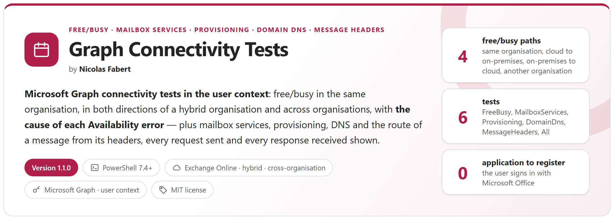
  </picture>
</p>

<p align="center">
  <a href="#why"><b>Why</b></a> &nbsp;&middot;&nbsp;
  <a href="#how-it-works"><b>How it works</b></a> &nbsp;&middot;&nbsp;
  <a href="#reports"><b>Reports</b></a> &nbsp;&middot;&nbsp;
  <a href="#quick-start"><b>Quick start</b></a> &nbsp;&middot;&nbsp;
  <a href="package/docs/GraphConnectivityTests-UserGuide.md"><b>User guide</b></a> &nbsp;&middot;&nbsp;
  <a href="package/docs/GraphConnectivityTests-Guide.md"><b>Developer guide</b></a>
</p>

<p align="center"><sub>Author: <b>Nicolas Fabert</b></sub></p>

> [!IMPORTANT]
> Files downloaded from the Internet may be blocked by Windows and fail to run. Before using this project, unblock every file in the downloaded folder:
>
> ```powershell
> Get-ChildItem "C:\Chemin\Du\Dossier" -Recurse -File -Force | Unblock-File
> ```
>
> Replace the example path with the folder where you downloaded or extracted this project.

## Why

When Alice cannot see Bob's free/busy, Outlook shows hatched cells and nothing else. Yet the request crosses many parts that each fail in their own way: where each mailbox is — Exchange Online or on-premises, which tenant —, the directory of the source organisation, the configuration Exchange Online uses for Bob's domain — IntraOrganizationConnector, organization relationship, availability address space —, the publication of the on-premises Availability service and its reverse proxy, the OAuth trust between the organisations, and the calendar permissions of Bob.

This tool replays that path **from your workstation, signed in as the source user, with Microsoft Graph** — the API that replaces EWS in Exchange Online — **stage by stage**, in the same organisation, **in both directions of a hybrid organisation** and **across organisations**. For each check it says what works, what does not, the **cause of each Availability error** and what to look at, with **the request it sent and the response it received**.

And when a message arrived late, went to Junk Email or was refused as spoofed, **its headers tell why**: `MessageHeaders` reads them on your workstation — no sign-in — and shows **the chronology from the sender to the mailbox**, the wait at each hop and who held the message, SPF, DKIM, DMARC and the spam verdict, each finding on its step with what to do, then **whether the DNS of today still explains it**.

<picture>
  <source media="(prefers-color-scheme: dark)" srcset="package/docs/images/readme-principles-dark.png">
  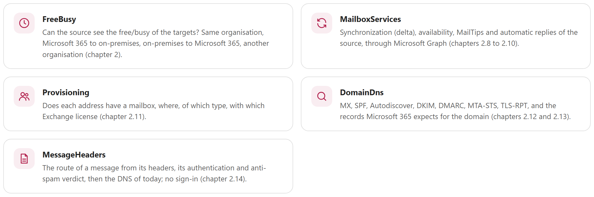
</picture>

## How it works

<picture>
  <source media="(prefers-color-scheme: dark)" srcset="package/docs/images/readme-how-it-works-dark.png">
  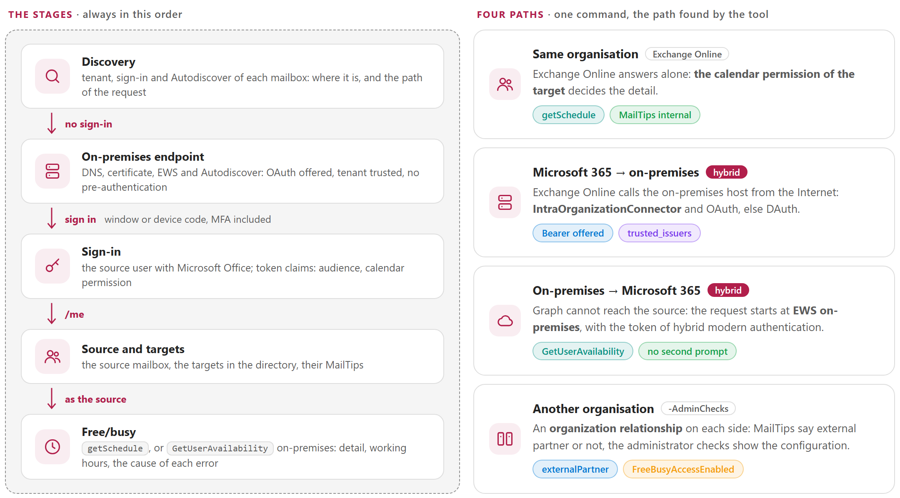
</picture>

- **No application to register**: the source user signs in with *Microsoft Office*, a public client of Microsoft present in every tenant and pre-authorized for Microsoft Graph — sign-in window (Microsoft Edge or Google Chrome, temporary profile) or device code, MFA and Conditional Access included. *Microsoft Graph Command Line Tools* or your own multi-tenant application when you prefer; your application with a certificate for automation.
- **Finds the path like Exchange does**: the Entra ID tenant and Autodiscover of each mailbox say where it is; then the path — same organisation, Microsoft 365 to on-premises, on-premises to Microsoft 365, another organisation.
- **Checks the on-premises side like Exchange Online sees it**: public DNS, certificate, and what EWS and Autodiscover answer without credentials — OAuth offered, your tenant trusted, no reverse proxy with pre-authentication.
- **Asks as the source**: Microsoft Graph `getSchedule`, or EWS `GetUserAvailability` on-premises when the source is there (token of hybrid modern authentication, no second prompt). Each error comes with its cause for this path: `ErrorMailRecipientNotFound`, `ErrorAvailabilityConfigNotFound`, `ErrorNoFreeBusyAccess`, `ErrorProxyRequestProcessingFailed`...
- **Optional administrator view** (`-AdminChecks`): the IntraOrganizationConnector, organization relationships and availability address spaces Exchange Online uses for each domain, read through the Exchange Online administration API (best effort: that API is not documented as public).
- **Safe on a production organisation**: read-only, except the automatic replies with `-AllowWrite` (scheduled, read back and restored, only when disabled). Nothing is changed in Entra ID or Exchange. Tokens are never written.

| Test | What it checks |
|---|---|
| `FreeBusy` | The free/busy of the targets, as the source sees it: `-SourceMailbox`, `-TargetMailbox`, `-OnPremisesHost`, `-SkipOnPremisesChecks`, interactive OAuth sign-in to Microsoft 365; for a source mailbox on-premises, OAuth (hybrid modern authentication), the Windows account, or an account typed in NTLM, Negotiate or Basic (`-OnPremisesCredential`) |
| `MailboxServices` | Synchronization, notification, availability and automatic replies of the source mailbox |
| `Provisioning` | Whether each address has a mailbox, where, of which type, with which Exchange license |
| `DomainDns` | The DNS records of a domain for Exchange Online |
| `MessageHeaders` | The route of a message from its headers (`-HeaderFile` `.eml`/`.txt`, or `-HeaderText`): sender, each hop with its wait and who held it (gateway, Exchange on-premises, Microsoft 365), the mailbox; SPF, DKIM, DMARC, composite authentication, spam verdict, hybrid attribution, Enhanced Filtering; then the DNS of today (`-SkipDnsCrossCheck` to leave it out, `-DnsServer` for another DNS server; read offline when no DNS answers). No sign-in |

## Reports

<table>
  <tr>
    <td width="50%" valign="top"><a href="package/docs/images/gct-report-overview.png">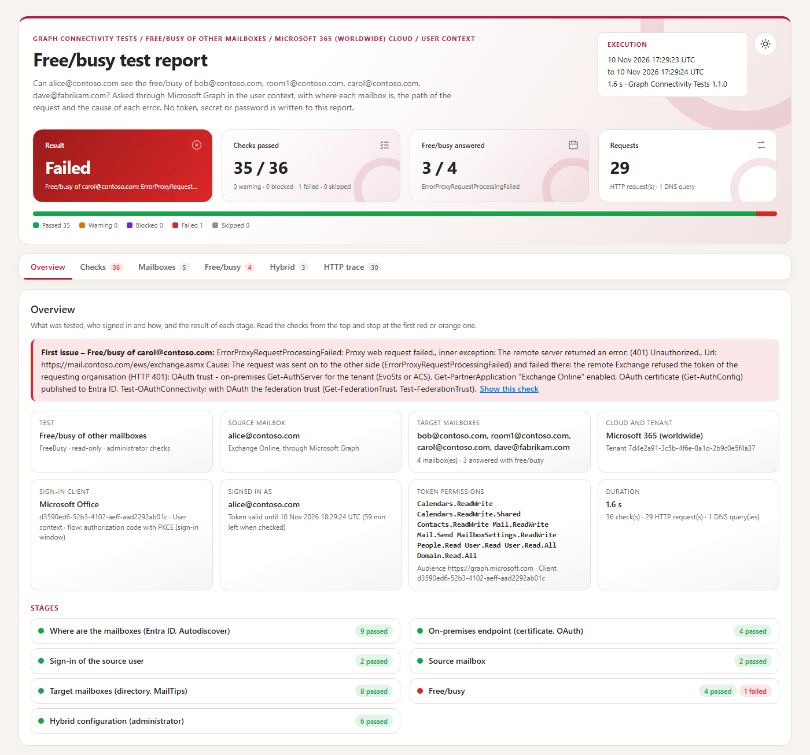</a><br><sub><b>HTML report</b> &middot; result, what was tested, and the checks in order with the requests under each one</sub></td>
    <td width="50%" valign="top"><a href="package/docs/images/gct-report-freebusy.png">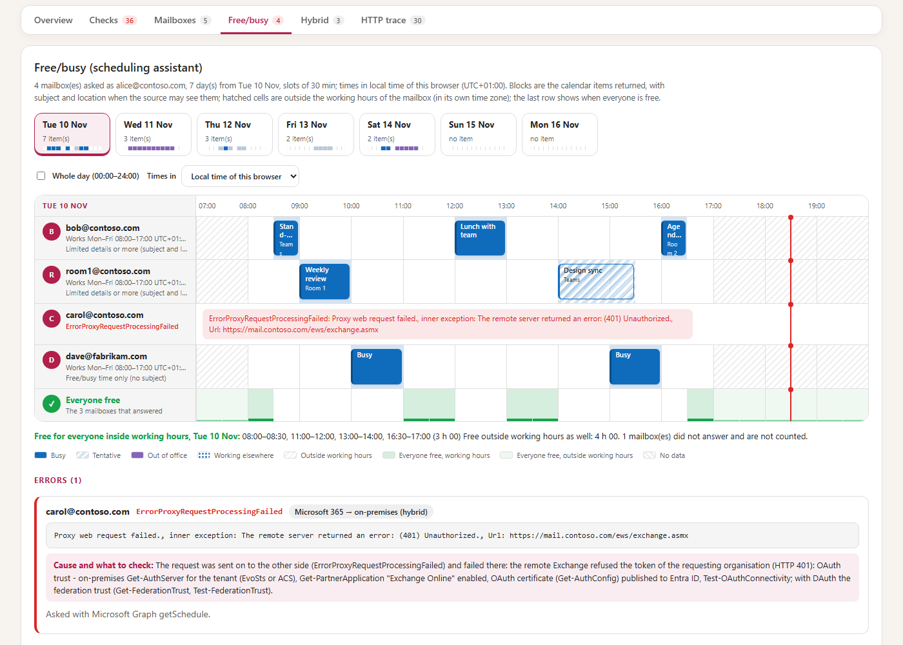</a><br><sub><b>Free/busy</b> &middot; one row per target, working hours, and the error and its cause for a mailbox without free/busy</sub></td>
  </tr>
  <tr>
    <td width="50%" valign="top"><a href="package/docs/images/gct-report-trace.png">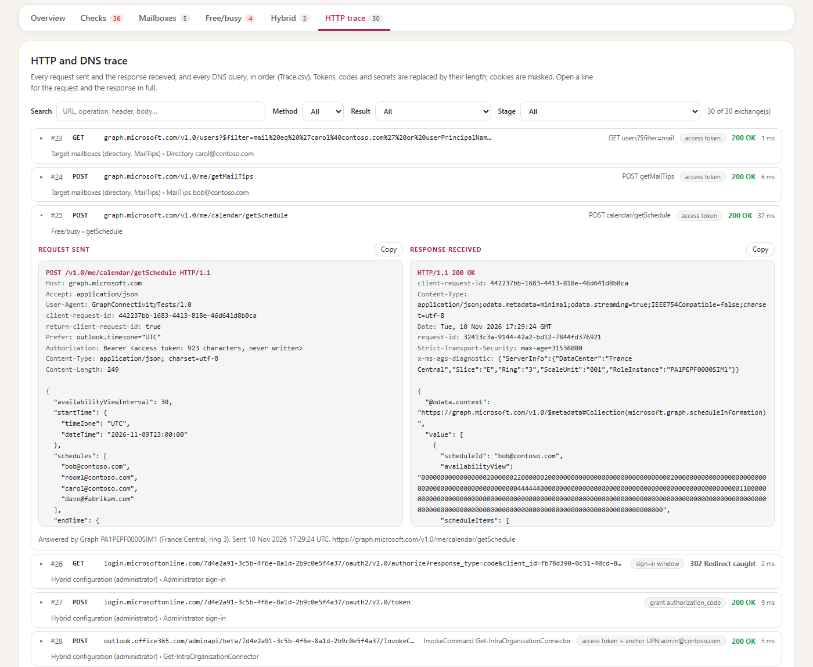</a><br><sub><b>Request sent, response received</b> &middot; for every check: headers, JSON and SOAP indented; tokens masked</sub></td>
    <td width="50%" valign="top"><a href="package/docs/images/gct-console.png">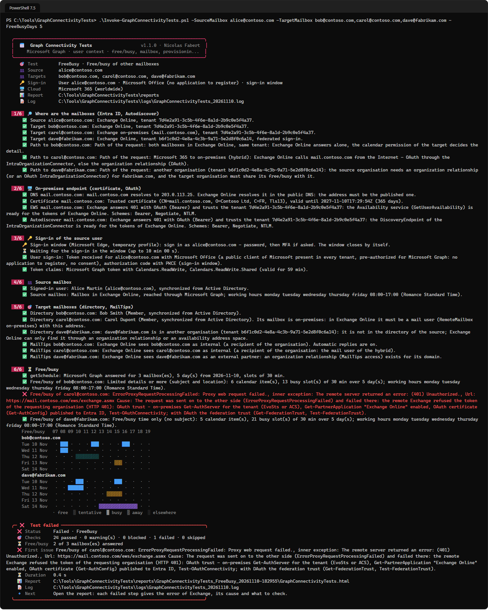</a><br><sub><b>Console</b> &middot; the stages, the checks and the free/busy map of the targets</sub></td>
  </tr>
  <tr>
    <td width="50%" valign="top"><a href="package/docs/images/gct-gui.png">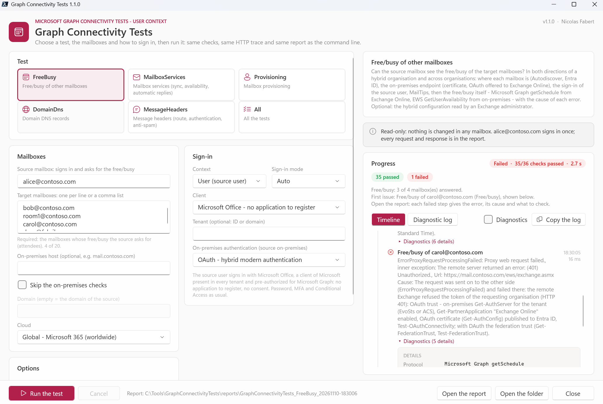</a><br><sub><b>Window</b> &middot; choose the test, the mailboxes and the sign-in, follow the progress, open the report</sub></td>
    <td width="50%" valign="top"><a href="package/docs/images/gct-gui-dark.png">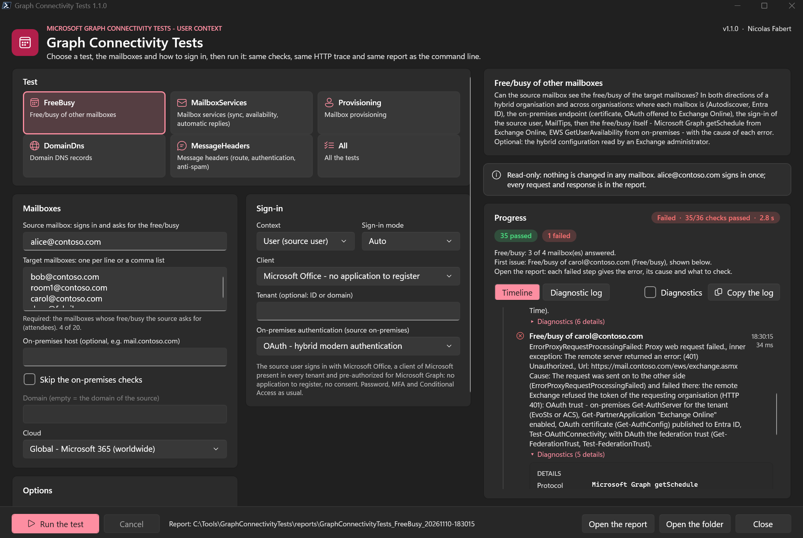</a><br><sub><b>Window, dark theme</b> &middot; light or dark like Windows</sub></td>
  </tr>
  <tr>
    <td width="50%" valign="top"><a href="package/docs/images/gct-gui-headers.png">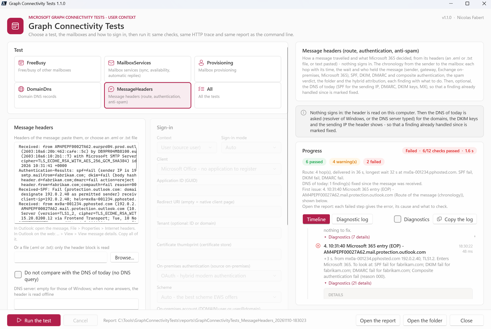</a><br><sub><b>Message headers</b> &middot; the chronology from the sender to the mailbox, each step with its findings</sub></td>
    <td width="50%" valign="top"><a href="package/docs/images/gct-report-route.png">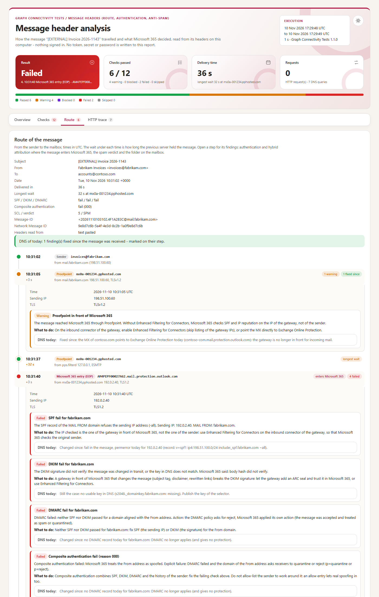</a><br><sub><b>Route of a message</b> &middot; the wait at each hop, the longest one marked, and the DNS of today</sub></td>
  </tr>
</table>

Each run writes `Steps.csv` (one row per check), `Mailboxes.csv` (where each mailbox is and the path), `FreeBusy.csv` and `Events.csv`, `Provisioning.csv`, `Dns.csv`, `Actions.csv` (what the run changed), `Route.csv` (the chronology of a message), `Trace.csv` (every HTTP request and response, every DNS query), `Summary.json` and a self-contained HTML report.

## Requirements

| Item | Requirement |
|---|---|
| Workstation | Windows 10 / 11 or Windows Server 2016 to 2025, **PowerShell 7.4** or later (7.5 or later for the Windows 11 look of the window). Nothing to install; in the domain or not. |
| Browser | Microsoft Edge or Google Chrome, for the sign-in window. Without one, a device code is shown instead. |
| Network | HTTPS to `login.microsoftonline.com`, `graph.microsoft.com` and `outlook.office365.com`, and to the on-premises Exchange when one is involved. |
| Account | The **source mailbox** and its password (and its MFA); none for `MessageHeaders`. No app registration with the default client. An Exchange administrator for `-AdminChecks`; an app registration with a certificate and admin consent for the Application context. |
| Exchange | Exchange Online; in hybrid, Exchange Server published for the Availability service, with hybrid modern authentication for a source on-premises (or Windows authentication from a computer of the domain). |

## Quick start

```powershell
git clone https://github.com/Nico77600/GraphConnectivityTests.git
cd GraphConnectivityTests\package
notepad .\config\GraphConnectivityTests.config.psd1     # the source mailbox and the target mailboxes

.\Invoke-GraphConnectivityTests.ps1 -SourceMailbox alice@contoso.com -TargetMailbox bob@contoso.com              # can Alice see Bob's free/busy?
.\Invoke-GraphConnectivityTests.ps1 -SourceMailbox alice@contoso.com -TargetMailbox onprem.user@contoso.com -OnPremisesHost mail.contoso.com -AdminChecks   # Microsoft 365 to on-premises
.\Invoke-GraphConnectivityTests.ps1 -SourceMailbox onprem.user@contoso.com -TargetMailbox alice@contoso.com       # on-premises to Microsoft 365
.\Invoke-GraphConnectivityTests.ps1 -SourceMailbox alice@contoso.com -TargetMailbox carol@fabrikam.com            # another organisation
.\Invoke-GraphConnectivityTests.ps1 -TestType Provisioning -SourceMailbox alice@contoso.com -TargetMailbox new.user@contoso.com
.\Invoke-GraphConnectivityTests.ps1 -TestType DomainDns -Domain contoso.com -SourceMailbox alice@contoso.com
.\Invoke-GraphConnectivityTests.ps1 -HeaderFile .\message.eml                                                     # what happened to this message?
.\Invoke-GraphConnectivityTests.ps1 -Gui                                                                         # the same in a window
```

One command per everyday question — can Alice see Bob's free/busy, hybrid in both directions, another organisation, why this Availability error, does this user have a mailbox, is the DNS of my domain right, what happened to this message, automation with an application: see the [user guide](package/docs/GraphConnectivityTests-UserGuide.md).

The repository `package` folder holds exactly the files needed to run, with the guides. The zip of each [release](https://github.com/Nico77600/GraphConnectivityTests/releases) contains the same run-time files with both HTML guides; `tools\New-GraphConnectivityTestsPackage.ps1` builds that zip from the repository.

## Documentation

| Guide | Content |
|---|---|
| **[User guide](package/docs/GraphConnectivityTests-UserGuide.md)** | For the people who run the tests: **prerequisites** and **everyday commands only** — can Alice see Bob's free/busy, hybrid in both directions, another organisation, why this Availability error, does this user have a mailbox, is the DNS of my domain right, what happened to this message, automation with an application. |
| **[Developer guide](package/docs/GraphConnectivityTests-Guide.md)** | Everything else: how it works stage by stage, the inputs of each test, the sign-in clients and why Microsoft Office needs no consent, the permissions of each test, the application context, the administrator checks, the configuration in detail, how to read the report and the HTTP trace, troubleshooting of the Availability errors, the architecture of the module, the tests and how to evolve the tool. |

Both guides also exist as a single HTML file with a light and a dark theme (`package/docs/GraphConnectivityTests-UserGuide.html`, `package/docs/GraphConnectivityTests-Guide.html`): download them and open them locally, or use the copies in the release zip.

## Tests

```powershell
.\Run-Tests.ps1      # Pester 6.1+, simulated Entra ID, Autodiscover, Microsoft Graph, Exchange and DNS, no connection
```

GitHub Actions runs the same tests and builds the package on PowerShell 7 for every pull request (see the [CHANGELOG](CHANGELOG.md)).

The code tables of the message header analysis (`package/data/header-codes.json`) and its sample headers (`tests/samples/headers`) are shared with the web page of Graph Connectivity Tests, a separate project: keep the copies identical, so that the tool and the page give the same results.

## License

[MIT](LICENSE).

## Disclaimer

This Script is a Personal project.
It's provided "AS-IS". It's not an official Microsoft product so no support can be expected from Microsoft.

As any scripts you must read carefully the documentation and test it first in a Test environment before any run in Production.

The administrator checks (`-AdminChecks`) use the administration API of the Exchange Online PowerShell module, which is not documented as a public API and can change. Use `-AllowWrite` only on a test mailbox.
