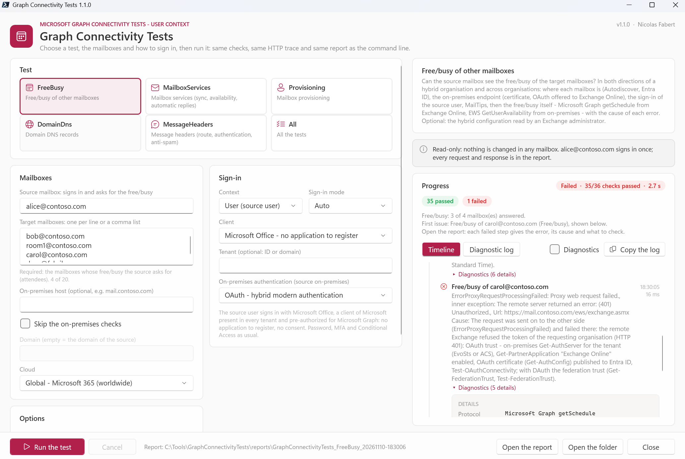
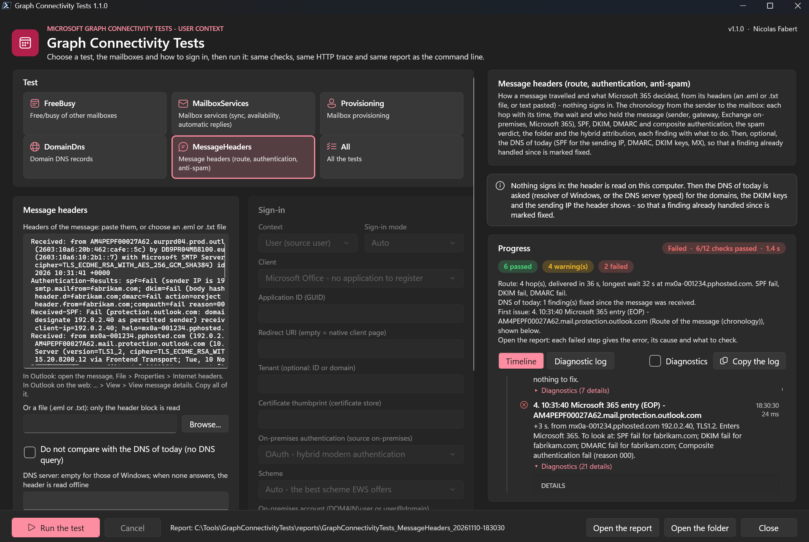
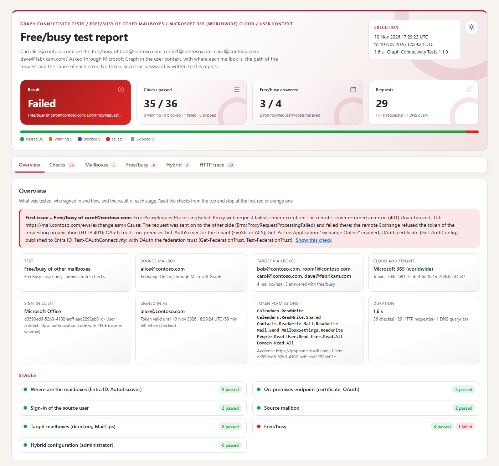
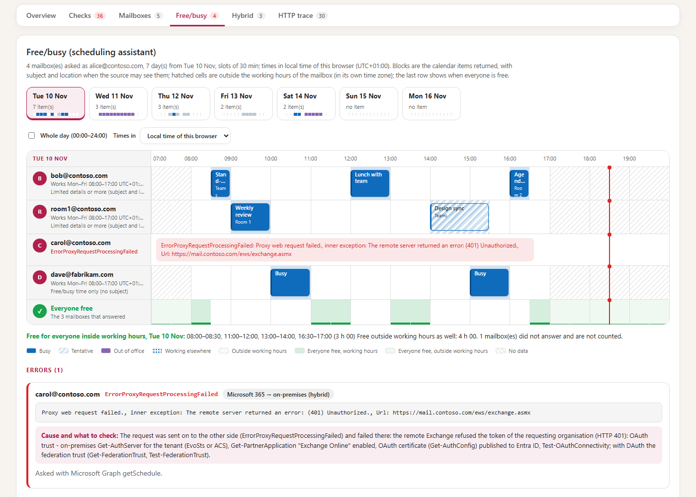
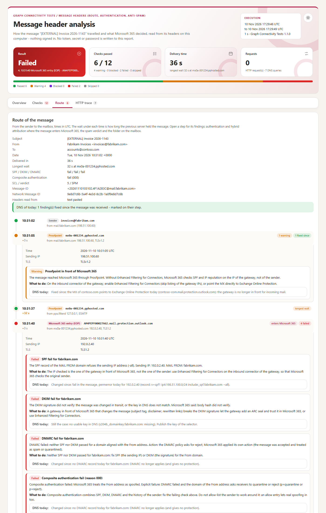
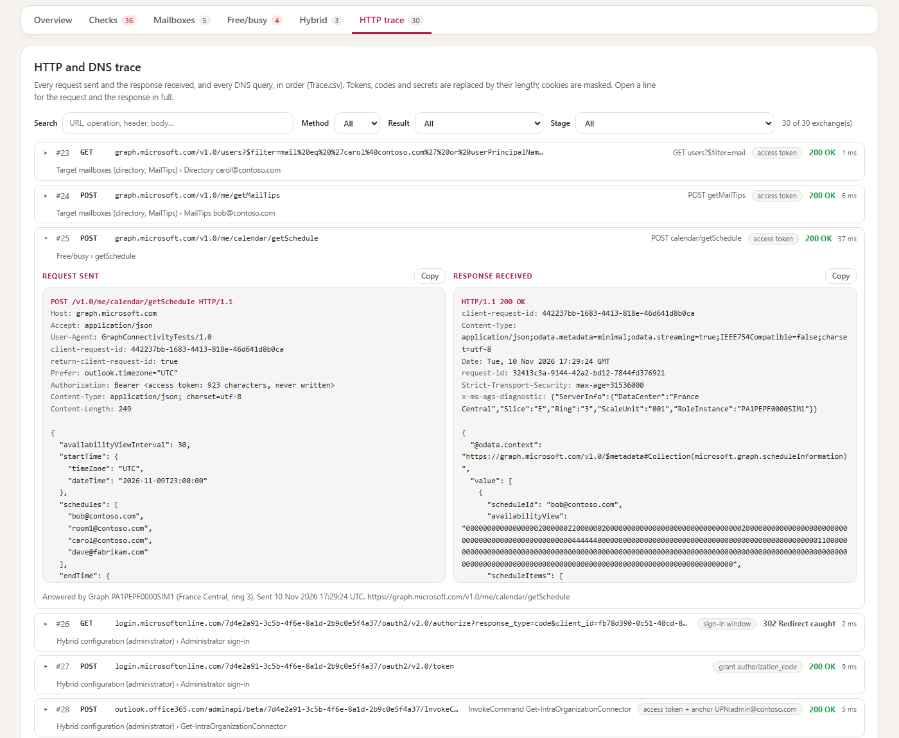

# Graph Connectivity Tests — Developer guide

> **Microsoft Graph connectivity tests in the user context**, with Microsoft Graph instead of EWS: the source user signs in — with *Microsoft Office*, no application to register — and asks the free/busy of the target mailboxes, in the same organisation, **in both directions of a hybrid organisation** and **across organisations**, with the cause of each Availability error. Plus the mailbox services, the mailbox provisioning, the DNS records of a domain, and the analysis of message headers (route, authentication, anti-spam, compared with the DNS of today). Every check shows **the request sent and the response received**.

> [!IMPORTANT]
> Files downloaded from the Internet may be blocked by Windows and fail to run. Before using this project, unblock every file in the downloaded folder:
>
> ```powershell
> Get-ChildItem "C:\Chemin\Du\Dossier" -Recurse -File -Force | Unblock-File
> ```
>
> Replace the example path with the folder where you downloaded or extracted this project.

> [!NOTE]
> This is the **developer guide**: how the tool works stage by stage, the inputs and the tests, the sign-in clients and the permissions of each test, the application context, the configuration in detail, the report and the HTTP trace, troubleshooting, the architecture and how to modify the tool. For the prerequisites and the everyday commands only, read the [user guide](GraphConnectivityTests-UserGuide.md).

```cards
clock | FreeBusy | Can the source see the free/busy of the targets? Same organisation, Microsoft 365 to on-premises, on-premises to Microsoft 365, another organisation (chapter 2).
refresh | MailboxServices | Synchronization (delta), availability, MailTips and automatic replies of the source, through Microsoft Graph (chapters 2.8 to 2.10).
people | Provisioning | Does each address have a mailbox, where, of which type, with which Exchange license (chapter 2.11).
search | DomainDns | MX, SPF, Autodiscover, DKIM, DMARC, MTA-STS, TLS-RPT, and the records Microsoft 365 expects for the domain (chapters 2.12 and 2.13).
file | MessageHeaders | The route of a message from its headers, its authentication and anti-spam verdict, then the DNS of today; no sign-in (chapter 2.14).
```

## Quick start

```steps
Install | Copy the folder, unblock the files, check PowerShell 7.4 or later (chapter 10).
Configure | Replace every `contoso.com` value in `config\GraphConnectivityTests.config.psd1` (chapter 11).
Run the free/busy test | `.\Invoke-GraphConnectivityTests.ps1 -SourceMailbox alice@contoso.com -TargetMailbox bob@contoso.com` — a sign-in window opens on the Microsoft page: sign in as Alice, password then MFA. Or `-Gui`.
Add the hybrid configuration | `-AdminChecks`: an Exchange administrator signs in once more and the tool reads how Exchange Online finds the free/busy of each domain (chapter 8).
Read the result | Open the HTML report named in the final card and stop at the first red or orange check (chapter 14).
```

> [!IMPORTANT]
> The tests read only, except `MailboxServices` (and `All`) with `-AllowWrite`: the automatic replies of the source are scheduled 60 days ahead, read back and restored — and only when they are disabled. Nothing is ever changed in Entra ID or in the Exchange configuration.

# Part I · Understand

<!-- icon: target -->
## 1. Purpose

When Alice cannot see Bob's free/busy, Outlook shows hatched cells and nothing else. The request crosses many parts that each fail in their own way: where each mailbox is (Exchange Online or on-premises, which tenant), the directory of the source organisation (is Bob known there, as a mailbox or a mail user?), the configuration Exchange Online uses for Bob's domain (IntraOrganizationConnector, organization relationship, availability address space), the publication of the on-premises Availability service (DNS, certificate, reverse proxy, OAuth), the OAuth trust between the organisations, and finally the calendar permissions of Bob.

Graph Connectivity Tests replays that path **from your workstation, signed in as the source user, through Microsoft Graph** — the API that replaces EWS in Exchange Online — and **isolates each stage**, with the HTTP request and response of each check.

### 1.1 Inputs and tests

The free/busy test takes these inputs, as keys of the configuration file or as parameters.

| Input | Configuration key · parameter |
|---|---|
| Source mailbox | `Target.SourceMailbox` · `-SourceMailbox` |
| Target mailboxes | `Target.TargetMailboxes` · `-TargetMailbox` (up to 20 in one run) |
| FQDN of the on-premises Availability service | `Target.OnPremisesHost` · `-OnPremisesHost` (a host name, without `https://` nor `/EWS/Exchange.asmx`) |
| Skip the on-premises URL checks | `Target.SkipOnPremisesChecks` · `-SkipOnPremisesChecks` |
| Sign-in to Microsoft 365 | the interactive OAuth sign-in of the source user (`Identity.Context User`): sign-in window or device code, MFA and Conditional Access included |
| Sign-in to Exchange on-premises | for a source mailbox **on-premises** (EWS), OAuth by default; or `Identity.OnPremisesAuthentication Credential` · `-OnPremisesCredential` with `-OnPremisesCredentialScheme Basic` (or `NTLM`, `Negotiate`, `Auto`). The account is typed when needed (or in the window); the password stays in memory and never reaches a file, the log or the trace. Exchange Online itself is always reached with OAuth. |

The tests:

| Test | What it checks | Done with |
|---|---|---|
| `FreeBusy` | the free/busy of the targets, as the source sees it | Microsoft Graph `getSchedule` (source in Exchange Online), EWS `GetUserAvailability` (source on-premises) |
| `MailboxServices` | synchronization, notification, availability and automatic replies of the source mailbox | `mailFolders/delta`, `messages/delta`, `getSchedule`, `getMailTips`, `mailboxSettings` |
| `Provisioning` | whether each address has a mailbox, where, of which type, with which Exchange license | `users`, `licenseDetails`, a probe of the Inbox (not read), `mailboxSettings/userPurpose` |
| `DomainDns` | the DNS records of a domain for Exchange Online | the DNS resolver of Windows, then `domains/{domain}/serviceConfigurationRecords` |
| `MessageHeaders` | how a message travelled and what Microsoft 365 decided, from its headers; then whether the DNS of today still explains it | the header block (`Target.HeaderFile` · `-HeaderFile`, or `Target.HeaderText` · `-HeaderText`), the DNS resolver of Windows; no sign-in |

Where each part of the test runs:

- **The on-premises checks are made from the workstation.** The *On-premises endpoint* stage resolves the host, opens TLS and calls EWS and Autodiscover like Exchange Online would. A firewall that lets only the Microsoft 365 addresses in will fail from the workstation while Exchange Online gets through: then use `-SkipOnPremisesChecks`.
- **The free/busy request itself is made by Exchange**: the source asks Exchange Online (or Exchange on-premises), which finds the target and calls the other side. The error it returns, and its message, are the real ones.
- **What Exchange Online is configured with** is not visible to the source user: read it with `-AdminChecks` (chapter 8).

<!-- icon: flow -->
## 2. How it works

```flow
search | Discovery | Tenant, sign-in, Autodiscover, path
server | On-premises | DNS, certificate, OAuth offered
key | Sign-in | Source user; token claims
people | Source and targets | Mailbox, directory, MailTips
clock | Free/busy | getSchedule or GetUserAvailability
settings | Hybrid | Optional: Exchange Online configuration
```

The stages run in order with one shared context (tokens, HTTP client, where each mailbox is, free/busy, records). Every check adds one **step** with a status. A failure of **Discovery** (of the source), **Sign-in** or **Source** stops the test: the next stages are *Skipped*. The other stages fail alone. The same engine runs the command line and the window.

### 2.1 Discovery — where are the mailboxes

No sign-in. For the source and each target:

- the **Entra ID tenant** of its domain, from the OpenID configuration (`https://login.microsoftonline.com/<domain>/v2.0/.well-known/openid-configuration`), with the region; a consumer domain (Outlook.com and others) is recognised and is not an organisation;
- **how the domain signs in** (`common/userrealm`): managed or federated, and the federation URL;
- **where the mailbox is**: Autodiscover v2 (JSON, anonymous) of Exchange Online first, then `autodiscover.<domain>`, redirects followed (HTTPS only). An EWS URL on `outlook.office365.com` means Exchange Online; another host means on-premises.

Steps: `Source <address>` and `Target <address>` (*Location*: `ExchangeOnline`, `OnPremises`, `External`, `Unknown`), then `Path to <target>` with the **path** of the request:

| Path | Meaning |
|---|---|
| `SameOrganisation` | both mailboxes in Exchange Online, same tenant: Exchange Online answers alone, the calendar permission of the target decides the detail |
| `CloudToOnPremises` | Microsoft 365 to on-premises: Exchange Online calls the on-premises host from the Internet — OAuth through the IntraOrganizationConnector, else the organization relationship (DAuth) |
| `OnPremisesToCloud` | on-premises to Microsoft 365: Exchange on-premises calls Exchange Online — OAuth through its IntraOrganizationConnector, else its organization relationship |
| `OnPremises` | both on-premises: no Microsoft 365 in the path |
| `CrossOrganisation` | another tenant, a consumer address or an organisation without Microsoft 365: an organization relationship (or an OAuth IntraOrganizationConnector, or an availability address space) is needed |
| `Unknown` | Autodiscover did not say where one of the mailboxes is |

A source outside any organisation fails the test; a source not found by Autodiscover and without a tenant too.

### 2.2 On-premises endpoint

Runs when a mailbox is on-premises or `Target.OnPremisesHost` is given, unless `SkipOnPremisesChecks`. For each host (`OnPremisesHost`, else the EWS hosts Autodiscover gave):

| Step | Passed when | Otherwise |
|---|---|---|
| `DNS <host>` | the name resolves (CNAME chain shown) | *Failed*: publish it in the public DNS |
| `HTTPS <host>` | TCP 443 answers | *Failed*: firewall, reverse proxy, Microsoft 365 addresses |
| `Certificate <host>` | trusted, name matches, TLS protocol shown | *Failed* (untrusted, or connection closed before the certificate: firewall, TLS inspection, TLS 1.2); *Warning* under `Test.CertificateWarningDays` days |
| `EWS <host>` | `POST /EWS/Exchange.asmx` without credentials answers `401` with `Bearer` and the tenant among `trusted_issuers` | redirect or sign-in page: *Failed* (reverse proxy with pre-authentication); `404`: *Failed*; no `Bearer`: *Warning* (OAuth not offered, DAuth fallback); tenant not trusted: *Warning* |
| `Autodiscover <host>` | the same for `POST /autodiscover/autodiscover.svc` (the *DiscoveryEndpoint* of the IntraOrganizationConnector) | same |

### 2.3 Sign-in

The source user signs in for Microsoft Graph (chapter 5), or the application (chapter 7). Steps: `User sign-in` (client, flow, browser, redirect URI, authority, scope asked), `Application sign-in` or `Access token` (supplied with `-AccessToken`), then `Token claims`: audience Microsoft Graph, **a calendar permission** in `scp` (user) or `roles` (application), the tenant of the source, not expired. A missing calendar permission is a *Warning* that names the fix; an expired token fails and stops the test. When the user principal name of the token differs from the source address, the step says so.

### 2.4 Source mailbox

- `Signed-in user`: `GET /me` (or `/users/<source>` for an application). Another account than the source is a *Warning*: `/me` is that person.
- `Source mailbox`: `getSchedule` of the source itself (one day, slots of 60 min) — it needs only a calendar permission and gives the working hours. It answers: the mailbox is in Exchange Online, **the free/busy request will go through Microsoft Graph**. It fails with `MailboxNotEnabledForRESTAPI` (or a similar code) and Autodiscover named an on-premises host, or `OnPremisesHost` is given: the mailbox is on-premises, **the request will go to EWS on-premises** like Outlook (User context only). Otherwise the step fails and stops the test.

### 2.5 Target mailboxes

- `Directory <target>`: the user of the tenant with this address as `mail`, `userPrincipalName`, then as a secondary address (`proxyAddresses`, advanced query with `ConsistencyLevel: eventual`). A target of another tenant is not looked up (its directory is not readable). An on-premises target must be a **mail user** in Exchange Online.
- `MailTips <target>`: `getMailTips` as the source — how Exchange Online sees the recipient: `internal`, `externalPartner` (an organization relationship shares MailTips), `external`. A target that should be internal (same organisation, hybrid) but is seen as external is a *Warning*: the domain is not accepted, or the mail user does not exist.

### 2.6 Free/busy

All the targets in one request, as the source, over `Test.FreeBusyDays` days from today in slots of `Test.FreeBusyIntervalMinutes`:

- source in Exchange Online: `POST /me/calendar/getSchedule` (`Prefer: outlook.timezone="UTC"`); step `getSchedule`;
- source on-premises: EWS `GetUserAvailability` (`DetailedMerged` view, `X-AnchorMailbox` of the source) on the on-premises EWS URL, with the OAuth token of hybrid modern authentication, the Windows account, or an account typed in NTLM, Negotiate or Basic (`Identity.OnPremisesAuthentication`); step `GetUserAvailability`, with the Exchange version, the servers and `X-MS-Diagnostics` of a refusal.

Then one step `Free/busy of <target>` per target: the **detail the source may see** (free/busy time only, or limited details with subject and location), the number of calendar items and busy slots, the **working hours** and their time zone — or the error code, its message and **the cause for this path** (appendix A). A target without error and without availability view is a *Warning*. The console then shows a free/busy map (7 days at most).

### 2.7 Hybrid configuration (administrator)

Only with `Test.AdminChecks` (`-AdminChecks`), chapter 8. Steps: `Administrator sign-in`; `Get-IntraOrganizationConnector`, `Get-OrganizationRelationship`, `Get-AvailabilityAddressSpace` (the objects read); `On-premises configuration` for a source on-premises (the commands to run there); `Domains` when every target is in the tenant; else one `Configuration for <domain>` per domain Exchange Online must find outside itself, in the order Exchange Online uses them:

| Exchange Online has, for the domain | Status |
|---|---|
| an **enabled IntraOrganizationConnector** (OAuth) | *Passed* — it wins over any organization relationship; *Warning* when its *DiscoveryEndpoint* is not the host checked by the On-premises stage |
| an **organization relationship** with `FreeBusyAccessEnabled` | *Passed* (level, endpoint); *Failed* when `FreeBusyAccessEnabled` is `False` |
| an **availability address space** | *Passed* (access method, proxy URL) |
| nothing | *Failed* — expect `ErrorAvailabilityConfigNotFound` |

A failure to sign in or to read a cmdlet is a *Warning* that gives the `Connect-ExchangeOnline` commands to read the same by hand; it never fails the test.

### 2.8 Synchronization

`MailboxServices` only, source in Exchange Online. `Folder synchronization`: `mailFolders/delta` until the `deltaLink` (pages of 50, 20 pages at most), then the `deltaLink` sent again must return only the changes — like `SyncFolderHierarchy` with a sync state. `Message synchronization`: the same on `messages/delta` of the Inbox, last 7 days, headers only — like `SyncFolderItems`. `Change notifications`: *Skipped* — Microsoft Graph sends them to a public HTTPS endpoint of an application, which a workstation does not have; delta is what a client without such an endpoint uses.

### 2.9 Availability

`Own free/busy` (`getSchedule` of the source over the period, like `GetUserAvailability`) and `Own MailTips` (mailbox full, maximum message size, automatic replies on or off).

### 2.10 Automatic replies

`Read the automatic replies`: `GET mailboxSettings/automaticRepliesSetting` (status, external audience, schedule), like `GetUserOofSettings`; a `403` is a *Warning* (the client lacks `MailboxSettings.Read`, chapter 6). `Change the automatic replies`:

| Situation | Status |
|---|---|
| no `-AllowWrite` | *Blocked* |
| `Application` context | *Skipped* (changed only in the User context) |
| automatic replies not disabled | *Skipped*: a real absence is never touched |
| scheduled 60 days ahead, read back as scheduled, restored (disabled, original messages) | *Passed* — like `SetUserOofSettings` |
| not restored | *Failed*: disable them in Outlook |

Both changes are recorded in *Actions*.

### 2.11 Provisioning

For each target (or the source when there is no target), step `Provisioning of <address>`: the user (mail, UPN, secondary address), synchronized from Active Directory, `assignedPlans` and `licenseDetails` (Exchange plans and their state), a **probe of the Inbox without reading it** — `200` own mailbox, `403` someone else's mailbox, `404 MailboxNotEnabledForRESTAPI` no mailbox in Exchange Online — and `mailboxSettings/userPurpose` (user, shared, room, equipment). No mailbox in Exchange Online is *Passed* when Autodiscover finds it on-premises, *Failed* otherwise (no Exchange license, or not provisioned yet). A mailbox without an enabled Exchange plan (other than shared, room or equipment) is a *Warning*. An address of another tenant is *Skipped*.

### 2.12 DNS records

No sign-in, the resolver of Windows (`Resolve-DnsName`), every query in the trace (method `DNS`). Domain: `Target.Domain`, else the domain of the source. Steps `MX` (Exchange Online Protection at the lowest preference, or a gateway), `SPF` (one record, Exchange Online included directly or through its includes — followed 3 levels deep — and the DNS lookups counted, 10 at most), `Autodiscover` (CNAME to `autodiscover.outlook.com`, or on-premises), `DKIM` (`selector1`, `selector2`), `DMARC` (policy), `MTA-STS` (record, then the policy file `https://mta-sts.<domain>/.well-known/mta-sts.txt`; TLS-RPT), `Device registration` (`enterpriseregistration`, `enterpriseenrollment`).

### 2.13 Records expected by Microsoft 365

Signed in: `Domain <domain>` (`GET /domains/<domain>`: verified, authentication type, services) and `Expected records` (`serviceConfigurationRecords`, each one resolved and compared). Records that do not match are a *Warning*, normal for the MX and Autodiscover while mail or mailboxes stay on-premises; optional records are *Skipped*.

### 2.14 Message headers

The `MessageHeaders` test reads the header block of a message — `Target.HeaderFile` · `-HeaderFile` (an `.eml` or `.txt` file; only the header block is read, the first 2 MB of a bigger file) or `Target.HeaderText` · `-HeaderText` — and **signs in nowhere**: no client, no permission, no request to Microsoft 365. Three stages:

- **HeaderRead** · *Message headers*: the fields, folded lines joined (RFC 5322) and encoded words decoded (RFC 2047, `B` and `Q`, any charset of .NET); the subject, From, To, Date, Message-ID, Network Message ID, tenant. Without any field the test stops. *Follow the message*: the commands to copy — `Get-MessageTraceV2 -MessageId` with a period of one day around the delivery, `Get-MessageTrackingLog` on every transport server on-premises, the Network Message ID for Microsoft Defender.
- **HeaderDns** · *Is it still the case? (DNS of today)*, unless `Test.SkipDnsCrossCheck` · `-SkipDnsCrossCheck`: with `Resolve-GctDns`, every query in the trace. *SPF today*: the SPF of the MAIL FROM domain **evaluated for the original sending IP** (`check_host()` of RFC 7208: `ip4`, `ip6` with prefixes, `a` and `mx` with their prefixes, `include`, `redirect`, `exists`, the four qualifiers, macros, 10 DNS lookups and 2 void lookups at most — beyond, `permerror`; `ptr` is not evaluated and the step says so). *DMARC today*: the record of the From domain, else of its organisational domain (policy, `sp`, `pct`, alignment modes). *DKIM key*: each selector of the signatures (published, revoked with an empty `p=`, missing; the size of the key), or `selector1` and `selector2` of Exchange Online when the message is not signed. *MX today*: the MX of the recipient domain, when a gateway was in front of Microsoft 365. These checks describe the DNS of today: they are *Passed* or *Warning*, never *Failed*.
- **HeaderRoute** · *Route of the message (chronology)*: one check per step, in time order — **the sender** (the *Date* field, the mail client, the client IP, the host and IP of the oldest *Received*), **each hop** (time in UTC, the wait before it, who held the message), **the mailbox** (folder, SCL, verdict). The status of a step is its worst finding.

**Who held the message.** Each *Received* is parsed (`from`, `by`, `with`, `id`, `for`, `via`, the date; comments taken out first, so that `with` inside `(version=TLS1_2 ...)` is not a clause; the IP and reverse DNS of the sending server; TLS). The server that received it is classified: a server of Microsoft 365 (`*.prod.outlook.com`, `*.protection.outlook.com`...) — the **entry into Microsoft 365** is the first one that received from outside or from the outbound servers of another tenant, before it the **sender tenant**, after it **Exchange Online** —; a **third-party gateway** (Proofpoint, Mimecast, Cisco Secure Email, Barracuda, Trend Micro, Sophos...); **Exchange on-premises** (an Exchange Server build in `id`, with its version); a **sending service**; else the **sender side**, or *after Microsoft 365*. The wait before a hop is the time the previous server held the message (queue and transfer); a hop dated before the previous one is a **clock skew** (wait shown as 0). The **longest wait** is marked: more than a minute is a note, more than five minutes a *Warning* with the tip for the segment that held it.

**Findings and their step.** *Authentication-Results* (the topmost: the verdict of the receiving organisation), *Received-SPF*, *DKIM-Signature*, ARC, *X-Forefront-Antispam-Report* (SFV, CAT, SFTY, SCL, IPV, DIR...), *X-Microsoft-Antispam* (BCL), *X-Microsoft-Antispam-Mailbox-Delivery* (folder and reason), the `-Untrusted` fields (the verdict of the **sending** organisation, not yours), *X-MS-Exchange-Organization-AuthAs*, *X-MS-Exchange-CrossTenant-FromEntityHeader*, *X-MS-Exchange-SkipListedInternetSender*... give one finding each, with what to do. The DMARC alignment is computed again (relaxed and strict, organisational domain of RFC 7489). Each finding is put on the step it is about: SPF, DKIM, DMARC, composite authentication, ARC and the hybrid attribution on the entry into Microsoft 365 (*On-premises message not recognised*: a message of Exchange on-premises received as anonymous Internet mail — the inbound connector of type OnPremises did not match); the Enhanced Filtering tip on the gateway; the spam verdict and the folder on the mailbox; Reply-To, Sender and a late *Date* on the sender. With the DNS of today, each finding that DNS can confirm gets a verdict: **still the case**, **fixed since**, **changed since**.

**One code table, one parser, two front ends.** The meanings of the codes (SFV, CAT, SFTY, IPV, SCL, BCL, compauth reasons, Mailbox-Delivery, AuthAs, FromEntityHeader, the gateways and sending services) are in `data\header-codes.json`, written from the public Microsoft documentation of the anti-spam message headers and the RFCs; values Microsoft does not document are marked *observed*. The web page of Graph Connectivity Tests (a separate project) uses the same file and the same parser rules, and the tests of both read the same anonymised samples (`tests\samples\headers`): the two give the same hops, findings and texts.

<!-- icon: layers -->
## 3. Tests

| Test | Stages, in order | Signs in | Changes something |
|---|---|---|---|
| `FreeBusy` | Discovery, OnPremises, SignIn, Source, Target, FreeBusy, Hybrid | yes | no |
| `MailboxServices` | SignIn, Source, Sync, Availability, AutoReply | yes | with `-AllowWrite` |
| `Provisioning` | Discovery, SignIn, Provisioning | yes | no |
| `DomainDns` | Dns, SignIn, DomainRecords | yes | no |
| `MessageHeaders` | HeaderRead, HeaderDns, HeaderRoute | no | no |
| `All` | Discovery, OnPremises, Dns, SignIn, Source, Target, FreeBusy, Hybrid, Sync, Availability, AutoReply, Provisioning, DomainRecords | once | with `-AllowWrite` |

*OnPremises* is left out with `SkipOnPremisesChecks`; *Hybrid* runs only with `AdminChecks`; *HeaderDns* is left out with `SkipDnsCrossCheck`. `All` does not include `MessageHeaders` (it needs a message). A failure of *HeaderRead* (no header field) stops the test. `Get-GctTestCatalog` lists the tests, `Get-GctScenarioStages -TestType <test> -Configuration <settings>` the stages a run will do.

<!-- icon: check -->
## 4. Results

| Status | Meaning |
|---|---|
| **Passed** | The check works. |
| **Warning** | It works, or could not be fully checked, with something to look at (the message says what). |
| **Blocked** | A writing step without `-AllowWrite`. |
| **Failed** | It does not work: the message gives the error, its cause and what to check. |
| **Skipped** | Not run: an earlier blocking stage failed, or the check does not apply. |

A stage that throws adds a *Failed* step named after the stage; a stage without any check adds *Nothing to check*. The **result** of the run is the worst status: Failed, then Blocked, then Warning, then Passed (*Skipped* alone never decides it).

Exit code: `0` passed, `1` failed, `2` warnings or blocked.

# Part II · Sign-in and permissions

<!-- icon: key -->
## 5. The user context and the clients

The source user signs in with OAuth. The tool is a public client (no secret): authorization code with **PKCE** in a sign-in window, or a **device code**. The authority is `Identity.TenantId`, else the tenant found for the domain of the source, else `organizations`.

| `Identity.ClientId` | Client | Redirect URI | Scope asked for Microsoft Graph | Consent |
|---|---|---|---|---|
| `MicrosoftOffice` (default) | *Microsoft Office*, `d3590ed6-52b3-4102-aeff-aad2292ab01c` | `https://login.microsoftonline.com/common/oauth2/nativeclient` | `https://graph.microsoft.com/.default` | none |
| `GraphCommandLineTools` | *Microsoft Graph Command Line Tools* (`Connect-MgGraph`), `14d82eec-204b-4c2f-b7e8-296a70dab67e` | `http://localhost` | named permissions (below) | user or administrator, once |
| an application ID | your application (multi-tenant if the users come from several tenants), redirect URI of type *Mobile and desktop applications* | `Identity.RedirectUri`, default the native-client URI | `.default` | as configured |

`offline_access openid profile` are always added: the **refresh token** gives the other tokens of the run without a new prompt.

**Why Microsoft Office needs no consent.** It is a first-party client of Microsoft, present in every tenant and **pre-authorized** by Microsoft for Microsoft Graph and Exchange (calendars, mail, directory read). Asking `<resource>/.default` gives exactly what it is pre-authorized for: no consent screen, nothing to register, nothing an administrator must approve. The tenant can still block it with Conditional Access, like any client.

**What it lacks.** Microsoft decides its permissions, not you, and they can change. Read `scp` in *Token claims*. Known gap: **`MailboxSettings.Read`** — the automatic replies (*Read the automatic replies* is a *Warning* with `403`) and the mailbox type of *Provisioning*. When a step answers `403` and names a permission, run again with `-ClientId GraphCommandLineTools`; `Identity.Scopes` lists the permissions to ask for (it replaces the default list):

`User.Read`, `User.ReadBasic.All`, `Calendars.Read`, `Calendars.Read.Shared`, `MailboxSettings.Read`, `Mail.ReadBasic`, `Domain.Read.All`

**Sign-in window or device code** (`Test.SignIn`). `Auto` opens the window when the session has a desktop and Microsoft Edge or Google Chrome is installed and allowed to be driven (the policy `RemoteDebuggingAllowed = 0` forbids it), else shows a device code. The window is an app window with a **temporary profile** (no account, cookie or extension of the workstation), driven through the DevTools protocol on the loopback interface; the tool catches the redirect that carries the code before the browser follows it, then closes the window and deletes the profile. The sign-in pages themselves are exchanged by the browser and are not in the trace. If the client refuses the redirect URI (`AADSTS50011`, `AADSTS500113`), `Auto` falls back to the device code. `Window` and `DeviceCode` force one way.

**EWS on-premises (source on-premises).** With `Identity.OnPremisesAuthentication OAuth` (default, hybrid modern authentication), the refresh token of the sign-in gives a token for `https://<on-premises host>` — a service principal name of *Office 365 Exchange Online* — with the scope `EWS.AccessAsUser.All` for Microsoft Office (`.default` for the other clients), like Outlook. With `Windows`, the current Windows account (Negotiate) is used, from a computer of the domain. With `Credential`, from any computer, an account and its password — `-OnPremisesCredential (Get-Credential)`, else asked when the source turns out to be on-premises, or the fields of the window — answer the challenge of EWS in the scheme `Identity.OnPremisesCredentialScheme`: `Auto` (default: the best one EWS offered in the on-premises step, Negotiate, then NTLM, then Basic), `NTLM`, `Negotiate` or `Basic` (sent at once, only over `https://`). The trace shows the scheme and the user name, never the password nor the NTLM messages; the step notes when the scheme asked is not offered by EWS.

<!-- icon: shield -->
## 6. Permissions per test

What each request needs (the permission the step names when it is refused):

| Stage · step | Request | User (delegated, `scp`) | Application (`roles`) |
|---|---|---|---|
| Source · *Signed-in user* | `GET /me` | `User.Read` | `User.Read.All` |
| Source · *Source mailbox*, FreeBusy, Availability · *Own free/busy* | `POST calendar/getSchedule` | a calendar permission: `Calendars.ReadBasic`, `Calendars.Read`, `Calendars.Read.Shared` or their `ReadWrite` forms | `Calendars.Read` or `Calendars.ReadBasic.All` |
| Target · *Directory* | `GET /users?$filter=` | `User.ReadBasic.All` | `User.Read.All` |
| Target · *MailTips*, Availability · *Own MailTips* | `POST getMailTips` | `Mail.Read` | `Mail.Read` |
| Sync | `mailFolders/delta`, `messages/delta` | `Mail.ReadBasic` | `Mail.ReadBasic` |
| AutoReply · read | `GET mailboxSettings/automaticRepliesSetting` | `MailboxSettings.Read` | `MailboxSettings.Read` |
| AutoReply · change (`-AllowWrite`) | `PATCH mailboxSettings` | `MailboxSettings.ReadWrite` | not done |
| Provisioning | `users` with `assignedPlans`, `licenseDetails` | `User.Read.All` | `User.Read.All` |
| DomainRecords | `GET domains/{domain}`, `serviceConfigurationRecords` | `Domain.Read.All` | `Domain.Read.All` |
| MessageHeaders | none: the header is read on the workstation, the DNS of today with the resolver of Windows | none | none |
| Hybrid (`-AdminChecks`) | Exchange Online administration API | an Exchange administrator role (View-Only Organization Management is enough) | the application with access to the Exchange Online administration API |

A `403` from Microsoft Graph names the missing permission and, for a user, the client to use instead; for an application, the admin consent and the scope of RBAC for Applications or of an application access policy.

<!-- icon: server -->
## 7. The application context

For a scheduled task: `Identity.Context Application`, `Identity.ClientId` (the application ID, a GUID), `Identity.CertificateThumbprint` (40 hexadecimal characters) and `Identity.TenantId` (tenant ID or domain) are required.

- The certificate is looked for in `Cert:\CurrentUser\My`, then `Cert:\LocalMachine\My`, and must have its private key. The tool signs a client assertion (JWT `RS256`, `x5t`, audience the token endpoint, valid 10 minutes) and asks `https://graph.microsoft.com/.default` with client credentials. No secret is supported.
- The checks use `/users/<source>` instead of `/me`; *Token claims* reads `roles`.
- Grant the application permissions of chapter 6 with admin consent; restrict them to the mailboxes tested with RBAC for Applications or an application access policy.
- Not available in this context: a source on-premises (EWS on-premises needs the user), changing the automatic replies (`MailboxServices` with `AllowWrite` is refused at start).
- `-AdminChecks` uses the same certificate for the Exchange Online administration API (resource `https://outlook.office365.com`).

<!-- icon: settings -->
## 8. Administrator checks

`-AdminChecks` reads, read-only, what Exchange Online uses to find the free/busy of each domain of the targets: `Get-IntraOrganizationConnector`, `Get-OrganizationRelationship`, `Get-AvailabilityAddressSpace`. The source user cannot see it.

- No module to install: the cmdlets are called through the **administration API of the ExchangeOnlineManagement module** (`POST https://outlook.office365.com/adminapi/beta/<tenant>/InvokeCommand`, `X-CmdletName`, `X-AnchorMailbox`), with its client, *Microsoft Exchange REST API Based PowerShell* (`Identity.AdminClientId ExchangeOnlinePowerShell`, `fb78d390-0c51-40cd-8e17-fdbfab77341b`), or an application ID.
- An **Exchange administrator** signs in once more during the run (View-Only Organization Management is enough).
- This API is **not documented as a public API** and can change: this part is best effort. A failure is a *Warning* with the commands to run by hand after `Connect-ExchangeOnline`; it never fails the test.
- The configuration of Exchange on-premises is out of reach from the Internet: for a source on-premises the step lists the commands to run there (`Get-IntraOrganizationConnector`, `Get-AuthServer`, `Test-OAuthConnectivity -Service EWS`).

# Part III · Set up

<!-- icon: checklist -->
## 9. Prerequisites

- PowerShell 7.4 or later (7.5+ for the Fluent theme of the window), Windows 10/11 or Windows Server 2016 to 2025. `DomainDns` and the DNS of today of `MessageHeaders` need `Resolve-DnsName` (Windows).
- HTTPS to `login.microsoftonline.com`, `graph.microsoft.com`, `outlook.office365.com` (Autodiscover, administration API), and to the on-premises Exchange when one is involved; Microsoft Edge or Google Chrome for the sign-in window.
- The source account (and its MFA); an Exchange administrator for `-AdminChecks`; an app registration with a certificate for the Application context.

<!-- icon: download -->
## 10. Installation

Copy the folder, then unblock the files: `Get-ChildItem <folder> -Recurse -File | Unblock-File`. Nothing else to install.

<!-- icon: settings -->
## 11. Configuration

`config\GraphConnectivityTests.config.psd1`, a PowerShell data file in sections. It is checked at start: unknown sections or keys and invalid values are all listed at once. The command-line parameters override it. No secret in the file.

| Section · key | Default | Values |
|---|---|---|
| `Target.SourceMailbox` | `alice@contoso.com` | SMTP address of the mailbox that signs in and asks; its domain is the default DNS domain |
| `Target.TargetMailboxes` | `@('bob@contoso.com')` | SMTP addresses, 20 at most (limit of `getSchedule`); at least one for `FreeBusy` |
| `Target.OnPremisesHost` | empty | FQDN of the on-premises Availability service; empty = the host Autodiscover gives |
| `Target.SkipOnPremisesChecks` | `$false` | `$true` skips the On-premises stage |
| `Target.Domain` | empty | `DomainDns`: the domain to check; empty = the domain of the source |
| `Target.Cloud` | `Global` | `Global`, `USGov` (GCC High), `USGovDoD`, `China` (21Vianet) |
| `Target.HeaderFile` | empty | `MessageHeaders`: an `.eml` or `.txt` file with the headers (relative to the tool folder, or absolute) |
| `Target.HeaderText` | empty | `MessageHeaders`: the headers as text (2 MB at most); one of `HeaderFile` and `HeaderText`, not both |
| `Identity.Context` | `User` | `User` or `Application` |
| `Identity.ClientId` | `MicrosoftOffice` | `MicrosoftOffice`, `GraphCommandLineTools`, `ExchangeOnlinePowerShell` or an application ID |
| `Identity.RedirectUri` | empty | redirect URI of your application; empty = the default of the client |
| `Identity.Scopes` | `@()` | Microsoft Graph permissions asked by name (replaces the default list of chapter 5) |
| `Identity.TenantId` | empty | tenant ID or domain; empty = the tenant of the domain of the source; required for `Application` |
| `Identity.CertificateThumbprint` | empty | `Application`: the certificate of the application |
| `Identity.OnPremisesAuthentication` | `OAuth` | `OAuth` (hybrid modern authentication), `Windows` (current Windows account) or `Credential` (an account and its password typed) |
| `Identity.OnPremisesCredentialScheme` | `Auto` | `Credential`: `Auto` (the best scheme EWS offers), `Negotiate`, `NTLM` or `Basic` |
| `Identity.OnPremisesUserName` | empty | `Credential`: user name proposed, `DOMAIN\user` or `user@domain` (empty = the source mailbox); the password is never stored |
| `Identity.AdminClientId` | `ExchangeOnlinePowerShell` | client of the administrator checks, or an application ID |
| `Test.DefaultType` | `FreeBusy` | `FreeBusy`, `MailboxServices`, `Provisioning`, `DomainDns`, `MessageHeaders`, `All` |
| `Test.SignIn` | `Auto` | `Auto`, `Window`, `DeviceCode` |
| `Test.AllowWrite` | `$false` | `$true` lets `MailboxServices` change the automatic replies |
| `Test.AdminChecks` | `$false` | `$true` adds the Hybrid stage |
| `Test.FreeBusyDays` | `7` | 1 to 62 |
| `Test.FreeBusyIntervalMinutes` | `30` | 5 to 1440 |
| `Test.OAuthPollTimeoutSeconds` | `600` | 30 to 3600: how long the sign-in may take |
| `Test.HttpTimeoutSeconds` | `60` | 5 to 600 |
| `Test.CertificateWarningDays` | `30` | 0 to 365 |
| `Test.MaxRetries` | `2` | 0 to 10: new attempts of a Microsoft Graph request after HTTP 429, 503 or 504 |
| `Test.UserAgent` | `GraphConnectivityTests/1.0` | `User-Agent` of the requests |
| `Test.SkipDnsCrossCheck` | `$false` | `MessageHeaders`: `$true` leaves out the DNS of today (no DNS query) |
| `Test.DnsServer` | `@()` | DNS servers asked (IP addresses or names) instead of those of Windows, for `DomainDns` and the DNS of today |
| `Test.DnsProbeName` | `microsoft.com` | `MessageHeaders`: name asked first; no answer means no DNS server answers, and the header is read offline |
| `Report.OutputPath` | `reports` | one folder per run under it |
| `Report.FilePrefix` | `GraphConnectivityTests` | prefix of the report files |
| `Report.Formats` | `@('Csv', 'Html')` | `Csv`, `Html` (`Summary.json` is always written) |
| `Report.CsvDelimiter` | `;` | `;`, `,` or a tab |
| `Logging.Path` | `logs` | daily log folder |
| `Logging.RetentionDays` | `14` | 1 to 3650 |

Relative paths are relative to the tool folder.

# Part IV · Use

<!-- icon: terminal -->
## 12. Command line

```powershell
.\Invoke-GraphConnectivityTests.ps1 [-TestType FreeBusy|MailboxServices|Provisioning|DomainDns|MessageHeaders|All]
    [-SourceMailbox <smtp>] [-TargetMailbox <smtp[]>] [-OnPremisesHost <fqdn>] [-SkipOnPremisesChecks] [-Domain <domain>]
    [-HeaderFile <file>] [-HeaderText <text>] [-SkipDnsCrossCheck] [-DnsServer <servers>]
    [-Cloud Global|USGov|USGovDoD|China] [-Context User|Application] [-ClientId <name or id>] [-RedirectUri <uri>]
    [-TenantId <id or domain>] [-CertificateThumbprint <thumbprint>] [-OnPremisesAuthentication OAuth|Windows|Credential]
    [-OnPremisesCredentialScheme Auto|Negotiate|NTLM|Basic] [-OnPremisesCredential <pscredential>]
    [-SignIn Auto|Window|DeviceCode] [-AllowWrite] [-AdminChecks] [-FreeBusyDays <n>]
    [-OutputPath <folder>] [-NoReport] [-ConfigPath <file>] [-Gui]
```

`-TargetMailbox` accepts a list (commas, semicolons or spaces). `-HeaderFile` or `-HeaderText` without `-TestType` selects `MessageHeaders`. `-AccessToken <token>` skips the sign-in with a Microsoft Graph token already obtained — for integration only: it can stay in the PowerShell history, and the tool warns about it. `Get-Help .\Invoke-GraphConnectivityTests.ps1 -Full` lists every parameter with examples.

The module can also be used directly:

```powershell
Import-Module .\GraphConnectivityTests.psd1
$settings = Import-GctConfiguration
$settings.TargetMailboxes = @('bob@contoso.com')
$result = Invoke-GctConnectivityTest -Configuration $settings -TestType FreeBusy -Quiet
$result.FreeBusy | Format-Table Mailbox, Status, ResponseCode, DetailLevel, WorkingHours
Export-GctReport -Result $result -OutputPath .\reports
```

<!-- icon: layers -->
## 13. Window



`-Gui` opens the window: the same tests, the same engine and the same report as the command line, the progress shown live as a timeline of the stages (a stage without problem folds; each check unfolds its details and its HTTP exchanges, request and response) or as a diagnostic log in time order (copied whole with *Copy the log*), the device code shown when there is one; a test can be cancelled.

For `MessageHeaders` the *Mailboxes* card becomes *Message headers*: a box to paste the headers, a file chosen with *Browse* (text pasted wins over a file), and *Do not compare with the DNS of today*; the sign-in and the options are not used. The chronology is the stage *Route of the message*: one check per step, its *Diagnostics* with the facts of the step, its findings (what to do, the verdict of the DNS of today), the raw *Received* field and the header fields each finding is read from.



<!-- icon: chart -->
## 14. Reading the report

The HTML report has: the result and the counts; **what was tested** (test, source and targets, cloud, client and sign-in flow, signed-in user, tenant, token audience and permissions, protocol of the source and its EWS URL, on-premises host, domain); the **checks** in order, grouped by stage, with under each one the requests it sent; then the data of the run — free/busy, mailboxes and their path, provisioning, DNS records, changes — and the **HTTP trace**.



### 14.1 The free/busy view

One row per target with the calendar items Exchange returned (busy, tentative, out of office, working elsewhere; subject and location when the source may see them), the working hours of the mailbox in its time zone, and the error and its cause on the row of a mailbox without free/busy. The same data are in `FreeBusy.csv` (one line per target) and `Events.csv` (one line per item).



The console shows a map per mailbox and day, one cell per hour from 07:00 to 20:00 (· free, ▒ tentative, █ busy, ▓ away, ░ elsewhere; `. ~ # O w` with `GCT_ICONS=Ascii`).

### 14.2 The route of a message

For `MessageHeaders`, the *Route* tab: the message in a few values (subject, From, To, delivered in, longest wait, SPF / DKIM / DMARC, composite authentication, SCL and verdict), then the chronology on a rail — the sender, each hop with its time, its wait and who held it, the mailbox — each step unfolding its findings with what to do and the verdict of the DNS of today, and the commands to follow the message. The same steps are in `Route.csv`, and the whole analysis (every field of the header, every finding) in `Summary.json` (`Headers`, `HeaderSummary`).



### 14.3 The HTTP trace

Click a request: the request sent and the response received, headers and body (JSON and SOAP indented, HTML summarised). DNS queries are in the same trace. What to look at:



| Header or element | Meaning |
|---|---|
| `client-request-id`, `request-id` | to find the request on the side of Microsoft (sent with `return-client-request-id: true`); the request ID is also in the details of the step |
| `x-ms-ags-diagnostic` | the Microsoft Graph server that answered (datacentre, ring) |
| `Retry-After` | throttling: the tool waits as asked (120 s at most) and tries again, `Test.MaxRetries` times |
| `error.code`, `error.message` (Graph) | the refusal: `ErrorAccessDenied`, `MailboxNotEnabledForRESTAPI`, `ResourceNotFound`… |
| `scheduleInformation.error.responseCode` | the Availability error of one target (appendix A) |
| `WWW-Authenticate: Bearer` · `trusted_issuers` · `authorization_uri` | on-premises: OAuth offered, the tenants Exchange accepts tokens from |
| `X-FEServer`, `X-BEServer`, `X-CalculatedBETarget` | Exchange itself answered (not a reverse proxy), and its servers |
| `X-MS-Diagnostics` | the reason of an OAuth refusal by Exchange on-premises |
| `X-AnchorMailbox` | the mailbox an EWS or administration request routes to |
| `ServerVersionInfo`, `ResponseCode`, SOAP fault | the EWS answer of `GetUserAvailability` and the Exchange build |

Secrets never reach the trace: access, refresh and ID tokens, client assertions, device and authorization codes are replaced by their length; cookies are masked (except the affinity cookies of Exchange); the sign-in pages of the browser are not recorded.

<!-- icon: folder -->
## 15. Files produced

One folder per run, `reports\<prefix>_<test>_<yyyyMMdd-HHmmss>\`:

| File | Content |
|---|---|
| `<prefix>-Steps.csv` | every check: stage, name, status, message, details, duration, requests |
| `<prefix>-Mailboxes.csv` | where each mailbox is: domain, tenant, region, sign-in, location, EWS URL, path, Autodiscover |
| `<prefix>-FreeBusy.csv` | one line per target: status, response code, message, cause, protocol, path, detail, working hours |
| `<prefix>-Events.csv` | the calendar items returned |
| `<prefix>-Provisioning.csv` | user, synchronization, mailbox in Exchange Online, type, licenses and Exchange plans |
| `<prefix>-Dns.csv` | the records found and expected, and their status |
| `<prefix>-Actions.csv` | what the run changed (automatic replies scheduled and restored) |
| `<prefix>-Route.csv` | `MessageHeaders`: one line per step of the chronology (sender, hops, mailbox), its status and its findings |
| `<prefix>-Trace.csv` | every HTTP request and response and every DNS query (secrets masked) |
| `<prefix>-Summary.json` | the whole result, for scripts |
| `<prefix>.html` | the self-contained report |

CSV files are UTF-8 with BOM; a cell starting with `=`, `+`, `-` or `@` is prefixed with an apostrophe (no formula in Excel). A daily log in `logs\`. They contain directory and calendar data: protect them.

# Part V · Maintain

<!-- icon: gear -->
## 16. Architecture

| File | Role |
|---|---|
| `Invoke-GraphConnectivityTests.ps1` | command line: configuration, parameters, run, report, exit code |
| `GraphConnectivityTests.psd1` · `.psm1` | manifest; loader of the parts in the order of a run, exported functions |
| `src\…Console.ps1` | console output (colours, icons, cards, free/busy map) and the daily log |
| `src\…Config.ps1` | configuration schema, defaults and checks; clouds, known clients, scopes, tests and stages |
| `src\…Http.ps1` | the only HTTP call (`Send-GctHttpRequest`), the trace and the masking of secrets |
| `src\…OAuth.ps1` | helpers and OAuth building blocks shared with Web Services Client for Exchange: traced GET and form POST, TLS certificate, challenges, Entra ID errors, token claims, tenant and user realm |
| `src\…Browser.ps1` | the sign-in window (Edge or Chrome, DevTools protocol, temporary profile) |
| `src\…Auth.ps1` | sign-in: user (window, device code, refresh), application (certificate), administrator; *Token claims* |
| `src\…Discovery.ps1` | DNS query (`Invoke-GctDnsQuery`), tenant, realm, Autodiscover v2, path of each request; the On-premises stage |
| `src\…Graph.ps1` | Microsoft Graph requests (`Invoke-GctGraph`: throttling, request IDs), failure texts, the free/busy answers and the causes of the Availability errors (`Get-GctAvailabilityHint`) |
| `src\…Ews.ps1` | EWS `GetUserAvailability` for a source on-premises (OAuth or Windows) and its answer |
| `src\…FreeBusy.ps1` | the Source, Target and FreeBusy stages |
| `src\…ExchangeAdmin.ps1` | the optional Hybrid stage (Exchange Online administration API) |
| `src\…Mailbox.ps1` | the Sync, Availability, AutoReply and Provisioning stages |
| `src\…Dns.ps1` | the Dns and DomainRecords stages |
| `src\…Headers.ps1` | `MessageHeaders`: the header parser, the route and its segments, the findings and their step, the SPF evaluator (RFC 7208), the DNS of today and the verdicts; the HeaderRead, HeaderDns and HeaderRoute stages |
| `src\…Run.ps1` | `Add-GctStep` and `Invoke-GctConnectivityTest`: the stages in order, blocking stages, result |
| `src\…Report.ps1` | CSV, JSON and HTML report (`Export-GctReport`) |
| `src\…Gui.ps1` | the WPF window |
| `templates\Report.template.html` | the HTML report, filled with the JSON of the run |
| `data\header-codes.json` | the code tables of the message header analysis, shared with the web page of Graph Connectivity Tests |
| `config\GraphConnectivityTests.config.psd1` | the example configuration |

<!-- icon: beaker -->
## 17. Tests

`.\Run-Tests.ps1` runs the Pester tests (Pester 6.1 or later) in `tests\`, without any connection: `Send-GctHttpRequest` (HTTP) and `Invoke-GctDnsQuery` (DNS) are the only functions that reach the network, and the tests replace them with simulated answers. The results go to `artifacts\pester-results.xml`. The message header analysis is tested on the anonymised samples of `tests\samples\headers` (the same as the tests of the web page), the SPF evaluator against the simulated DNS. GitHub Actions runs the same command on PowerShell 7 (`.github\workflows\ci.yml`).

The repository tools (not in the package):

```powershell
.\tools\Build-Documentation.ps1                # the HTML guides (user guide, developer guide)
.\tools\New-ReadmeImages.ps1                   # the graphics of the README (light and dark)
.\tools\New-GraphConnectivityTestsPackage.ps1  # the release folder and zip: run-time files and the HTML guides only
```

<!-- icon: wrench -->
## 18. Evolving the tool

- **A new check in a stage**: an `Add-GctStep` call in the stage function, with a message that gives the cause and what to check, the permission it needs in `Get-GctGraphFailureText`, a simulated answer and a test.
- **A new stage**: an `Invoke-GctStage<Name>` function in the right `src` file, its entry in `$script:StageInfo` and in the stages of a test (`$script:Scenarios`, `Config.ps1`), its line in the `switch` of `Invoke-GctConnectivityTest` (`Run.ps1`); new data: a list in the context, a property of the result, its columns in `$script:ReportColumns` and its block in the template.
- **A new Availability error**: its code and cause in `Get-GctAvailabilityHint` (`Graph.ps1`), for every path.
- **A new cloud**: an entry in `$script:Clouds` (sign-in, Graph, Exchange Online, Exchange Online Protection hosts) and in the `Cloud` parameter.
- **A new known client**: an entry in `$script:KnownClients` (ID, name, redirect URI, explicit scopes or not).

# Appendices

<!-- icon: lifebuoy -->
## Appendix A. Troubleshooting

### Availability errors

The *Free/busy of …* step shows the code, the message and the cause the tool deduces for the path of the request. The message often names the remote error (`401`, `403`, `404`, `5xx`, connection, TLS, federation, Autodiscover): the cause then says which one.

| Response code | Cause and what to check |
|---|---|
| `ErrorMailRecipientNotFound`, `ErrorInvalidSmtpAddress` | Exchange does not know this address: no mailbox, mail user or contact with it in the source organisation (and, for a remote path, no organization relationship, IntraOrganizationConnector or availability address space for its domain). In hybrid, the on-premises mailbox must be a mail user in Exchange Online (directory synchronization). |
| `ErrorAvailabilityConfigNotFound`, `ErrorNoOrganizationRelationship`, `ErrorOrganizationNotFederated` | Exchange Online has no free/busy configuration for this domain: an organization relationship, an IntraOrganizationConnector (hybrid) or an availability address space with the domain in `DomainNames` / `TargetAddressDomains`. `-AdminChecks` shows which one exists. |
| `ErrorNoFreeBusyAccess` | The target refuses to share with the source: calendar permission *None* for Default, Anonymous or the source, or `FreeBusyAccessEnabled` / `FreeBusyAccessLevel None` in the organization relationship of the target organisation. |
| `ErrorProxyRequestProcessingFailed`, `ErrorProxyRequestNotAllowed`, `ErrorProxyCallFailed`, `ErrorProxyServiceDiscoveryFailed`, `ErrorServiceDiscoveryFailed`, `ErrorAutoDiscoverFailed`, `ErrorConnectionFailed`, `ErrorTimeoutExpired` | The request was sent on to the other side and failed there. **401**: the remote Exchange refused the token — on-premises `Get-AuthServer` for the tenant (EvoSts or ACS), `Get-PartnerApplication` *Exchange Online* enabled, the OAuth certificate (`Get-AuthConfig`) published to Entra ID, `Test-OAuthConnectivity`; with DAuth `Get-FederationTrust`, `Test-FederationTrust`. **403**: a reverse proxy, a firewall or an EWS policy (`EwsApplicationAccessPolicy`, `EwsEnabled`). **404**: `TargetSharingEpr`, `DiscoveryEndpoint` or `TargetAutodiscoverEpr` points to a wrong address. **5xx**: the remote Exchange or its load balancer. **Connection**: public DNS name, firewall and reverse proxy must let the Microsoft 365 addresses in on TCP 443 (`/EWS` and `/Autodiscover` in pass-through). **TLS**: public certificate, complete chain, name, TLS 1.2. **Federation**: `Get-FederatedOrganizationIdentifier`, `Test-FederationTrust`. **Autodiscover**: `TargetAutodiscoverEpr` or `DiscoveryEndpoint`, and the publication of `/Autodiscover`. |
| `ErrorFreeBusyGenerationFailed` | Exchange found the mailbox but could not build its free/busy: calendar not readable, mailbox being moved, or a remote error — read the message. |
| `ErrorFreeBusyDLLimitReached`, `ErrorDistributionListMemberNotExist` | The address is a group: free/busy for 100 members at most, and only for a group Exchange can expand. |
| `ErrorServerBusy`, `ErrorTooManyObjectsOpened` | Exchange throttled the request: wait and try again. |
| `NoResponse` | `getSchedule` returned no information for this address. |

### Other symptoms

| Symptom | Cause and what to check |
|---|---|
| *Source mailbox* fails with `MailboxNotEnabledForRESTAPI` | the source is on-premises but no on-premises EWS URL is known: `-OnPremisesHost`. |
| *Token claims*: no calendar permission | the client is not allowed to read calendars: `-ClientId MicrosoftOffice`, or consent `Calendars.Read`; for an application, `Calendars.Read` with admin consent. |
| *Signed-in user*: another account | the browser signed in with another account: sign in with the source, or use a private window for the device code. |
| *GetUserAvailability* `401` (OAuth) | Exchange on-premises refused the token of hybrid modern authentication: EvoSts authorization server (`Get-AuthServer`), `OAuthAuthentication` on the EWS virtual directory, the URL among the service principal names of *Office 365 Exchange Online*; or try `-OnPremisesAuthentication Credential` (NTLM or Basic with the account of the source) or `Windows` from a computer of the domain. |
| *GetUserAvailability* `401` (Credential) | the account typed was refused: password, account locked or expired, user name format (`DOMAIN\user` or the UPN); the scheme must be enabled on the EWS virtual directory (`Get-WebServicesVirtualDirectory` `BasicAuthentication`, `WindowsAuthentication`) and kept by the reverse proxy. The step lists the schemes EWS offers. |
| *GetUserAvailability* `403` | EWS blocked for this user (`Get-CASMailbox` `EwsEnabled`, `EwsApplicationAccessPolicy`) or by a reverse proxy. |
| *EWS* / *Autodiscover &lt;host&gt;*: redirect or sign-in page | a reverse proxy with pre-authentication: publish `/EWS` and `/Autodiscover` in pass-through. |
| *EWS &lt;host&gt;*: no `Bearer` | OAuth not offered: `OAuthAuthentication` on the virtual directory, the Hybrid Configuration Wizard, a reverse proxy that drops `WWW-Authenticate: Bearer`. |
| *EWS &lt;host&gt;*: tenant not trusted | run the Hybrid Configuration Wizard (or `New-AuthServer` for the tenant). |
| *MailTips*: internal target seen as external | the domain is not an accepted domain, or the mail user / mailbox does not exist in Exchange Online. |
| `AADSTS500011` for the on-premises URL | the URL is not a service principal name of *Office 365 Exchange Online*: hybrid modern authentication not configured for it. |
| `AADSTS65001`, `AADSTS90094` | no consent for this client: grant it in Entra ID, or use `MicrosoftOffice`, which needs none. |
| `AADSTS50011`, `AADSTS500113` | the redirect URI is not one of the client: `Identity.RedirectUri`, or `-SignIn DeviceCode`. |
| `AADSTS53003`, `AADSTS530003` | Conditional Access blocked the sign-in, or requires a compliant device: read the sign-in log of the user. |
| `AADSTS700016` | the client ID does not exist in the tenant; a single-tenant application cannot sign in users of another tenant. |
| `AADSTS7000218` | the device-code flow needs a public client (*Allow public client flows*). |
| `AADSTS700027` | the certificate is not one of the application. |
| Hybrid: `401` / `403` on a cmdlet | the account is not an Exchange administrator (View-Only Organization Management), or the API did not accept the client. |
| *SPF*: more than 10 lookups, or several records | receivers answer `PermError`: merge the records, flatten the includes. |
| Headers: *On-premises message not recognised* | Exchange Online received a message of Exchange on-premises as anonymous Internet mail: the inbound connector of type OnPremises does not match — `TlsSenderCertificateName` equal to the certificate the on-premises Send connector presents (or `SenderIPAddresses`), `RequireTls`. |
| Headers: SPF fail behind a gateway | Microsoft 365 checked SPF on the IP of the gateway in front of it: Enhanced Filtering for Connectors on the inbound connector of the gateway, or the MX straight to Exchange Online Protection. |
| Headers: DMARC fail while SPF passes | the MAIL FROM domain is not aligned with the From domain: a custom return-path in the From domain, or DKIM signed with `d=` the From domain. |
| Headers: *Delivered to: Junk Email folder* with a low SCL | the mailbox moved it: an inbox rule (`Get-InboxRule`) or the Blocked Senders of the user (`Get-MailboxJunkEmailConfiguration`). |
| *MTA-STS*: policy not readable | `https://mta-sts.<domain>/.well-known/mta-sts.txt` must answer `200` with a `mode`. |

<!-- icon: shield -->
## Appendix B. Security and data

Access, refresh and ID tokens stay in memory: they are never written to the console, the log, the trace or the report. The trace masks tokens, client assertions, device and authorization codes and cookies (except the affinity cookies of Exchange). No password is typed into the tool: users sign in in the window of Microsoft or with a device code, applications with a certificate of the certificate store. The reports contain directory and calendar data, and for `MessageHeaders` every field of the header: keep them as such. `MessageHeaders` sends nothing anywhere: the DNS of today asks the resolver of Windows for names only (the domains of the header, the DKIM selectors, the reversed sending IP inside an SPF `exists` macro).

<!-- icon: tag -->
## Appendix C. Versions

MAJOR.MINOR.PATCH: MAJOR for an incompatible change of the configuration or the result, MINOR for a feature, PATCH for a fix. See `CHANGELOG.md`.
