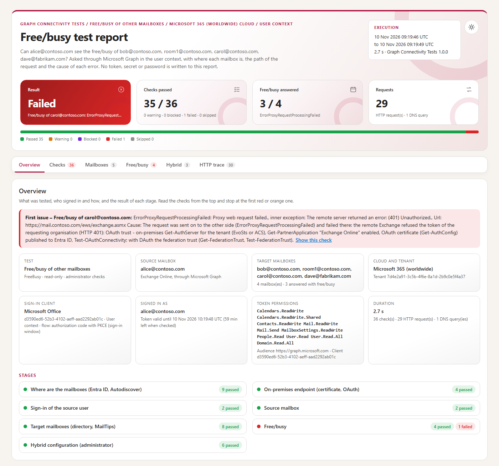
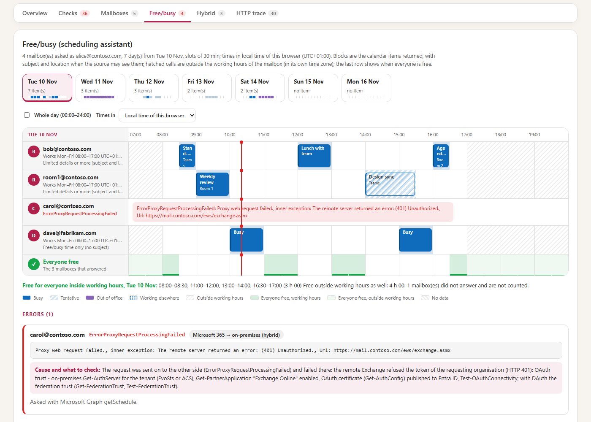
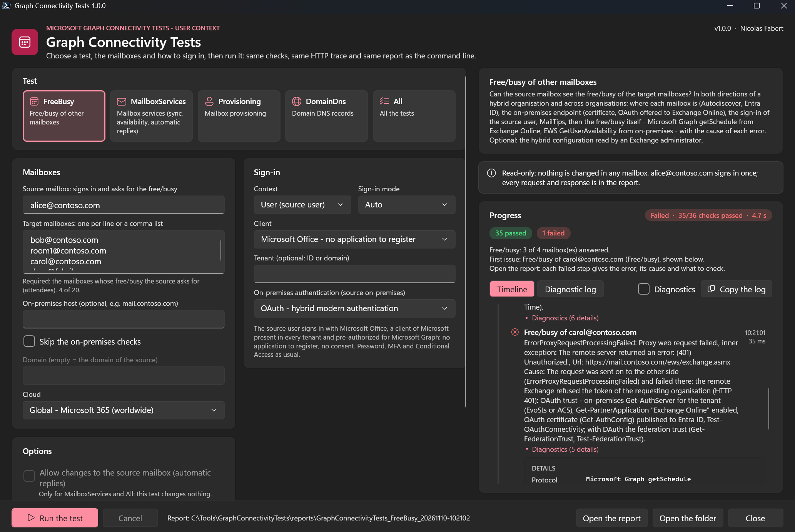
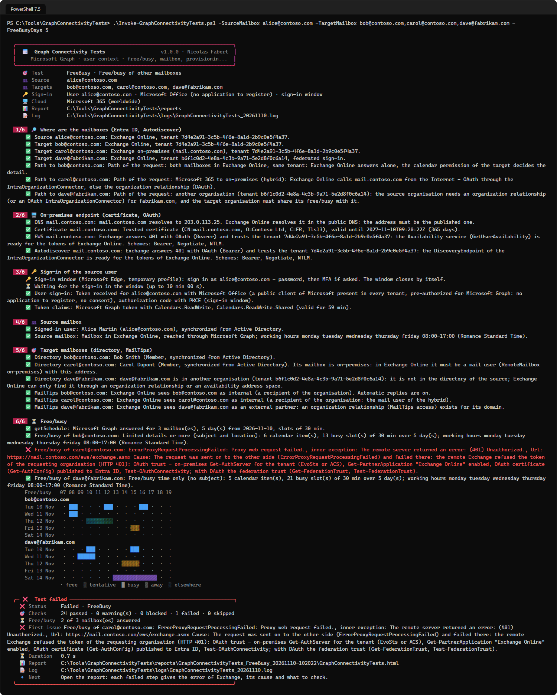

# Graph Connectivity Tests — User guide

> What you need before the first test, then one command per everyday question: **can Alice see Bob's free/busy?**, **does it work from Microsoft 365 to on-premises, and back?**, **with another organisation?**, **why this Availability error?**, **does this user have a mailbox?**, **is the DNS of my domain right?** How the tool works, the sign-in clients and their permissions, the configuration in detail, the report and the internals are in the [developer guide](GraphConnectivityTests-Guide.md).

> [!IMPORTANT]
> Files downloaded from the Internet may be blocked by Windows and fail to run. Before using this project, unblock every file in the downloaded folder:
>
> ```powershell
> Get-ChildItem "C:\Chemin\Du\Dossier" -Recurse -File -Force | Unblock-File
> ```
>
> Replace the example path with the folder where you downloaded or extracted this project.

```cards
checklist | Prerequisites | Chapter 1: the workstation, the browser, the network, the account that signs in, then the one-time setup.
terminal | Everyday use | Chapter 2: one command per question, with the step of the report that answers it.
compare | Which test? | Chapter 3: FreeBusy, MailboxServices, Provisioning, DomainDns or All, and the options used most.
file | Results | Chapter 4: the console, the report, the files and the exit codes.
```

<!-- icon: checklist -->
## 1. Prerequisites

| Item | Requirement |
|---|---|
| Workstation | Windows 10 / 11 or Windows Server 2016 to 2025, **PowerShell 7.4** or later (7.5 or later for the Windows 11 look of the window). Nothing to install. It does not have to be in the domain. |
| Browser | Microsoft Edge or Google Chrome, for the sign-in window. Without one (or on a server without a desktop), a device code is shown instead. |
| Network | HTTPS to `login.microsoftonline.com`, `graph.microsoft.com` and `outlook.office365.com`; to the on-premises Exchange when one is involved; DNS queries for `DomainDns`. |
| Account | The **source mailbox**: the user who asks for the free/busy signs in, with its password and its MFA. The test runs as this user. |

**No application to register.** By default the source user signs in with *Microsoft Office*, a public client of Microsoft present in every tenant and already allowed to read calendars through Microsoft Graph: no consent to ask, nothing to create in Entra ID.

Only these cases need something more:

| Case | What is needed |
|---|---|
| A step says a permission is missing (HTTP 403 and the permission name) | `-ClientId GraphCommandLineTools`, the client of `Connect-MgGraph`: the user, or an administrator, consents once. |
| `-AdminChecks` (the hybrid configuration read in Exchange Online) | An **Exchange administrator** account (View-Only Organization Management is enough); it signs in a second time during the run. |
| `-Context Application` (scheduled task, no user) | Your app registration, a certificate in the certificate store, application permissions with admin consent: [developer guide, chapter 7](GraphConnectivityTests-Guide.md#7-the-application-context). |
| The source mailbox is on-premises | Hybrid modern authentication on Exchange on-premises; or the account of the source typed in NTLM or Basic (`-OnPremisesCredential`), from any computer; or `-OnPremisesAuthentication Windows` from a computer of the domain, signed in as the source user. |

### 1.1 One-time setup

```steps
Copy the tool | Download `GraphConnectivityTests-<version>.zip` from the latest release, extract it (for example in `C:\Tools`) and unblock the files. No installer.
Name your mailboxes | `notepad .\config\GraphConnectivityTests.config.psd1`: replace the `contoso.com` values — the source mailbox and the target mailboxes. Every value can also be given on the command line or typed in the window.
First test | `.\Invoke-GraphConnectivityTests.ps1 -SourceMailbox alice@contoso.com -TargetMailbox bob@contoso.com`: a sign-in window opens on the Microsoft page — sign in as Alice, password then MFA. The window closes by itself.
Read the result | Open the HTML report named at the end and stop at the first red or orange check.
```

<!-- icon: terminal -->
## 2. Everyday use

Every command below writes a report: open it and **stop at the first red or orange check** — it says what failed, why, and what to look at, with the request sent and the response received. What is not given on the command line comes from the configuration file. `FreeBusy` is the default test.

### 2.1 Can Alice see Bob's free/busy?

```powershell
.\Invoke-GraphConnectivityTests.ps1 -SourceMailbox alice@contoso.com -TargetMailbox bob@contoso.com

# Several targets at once (20 at most), over 14 days
.\Invoke-GraphConnectivityTests.ps1 -SourceMailbox alice@contoso.com -TargetMailbox bob@contoso.com,room1@contoso.com -FreeBusyDays 14
```

The test finds where each mailbox is (Entra ID, Autodiscover) and the **path** of the request, signs Alice in, looks up the targets in the directory and their **MailTips** (how Exchange Online sees each one: internal, external partner, external), then asks the free/busy with Microsoft Graph `getSchedule`, as Alice. *Free/busy of bob@contoso.com* gives the detail Alice may see (free/busy only, or subject and location), the number of items and Bob's working hours — or the error and its cause.



> [!TIP]
> On a server without a browser, add `-SignIn DeviceCode`: type the code on any other device (in a private window if that browser is already signed in with another account).

### 2.2 Hybrid: from Microsoft 365 to on-premises

Alice is in Exchange Online, Bob is still on-premises. Exchange Online must call the on-premises Availability service from the Internet.

```powershell
.\Invoke-GraphConnectivityTests.ps1 -SourceMailbox alice@contoso.com -TargetMailbox onprem.user@contoso.com

# The on-premises host is not the one Autodiscover gives, and the configuration of Exchange Online is read too
.\Invoke-GraphConnectivityTests.ps1 -SourceMailbox alice@contoso.com -TargetMailbox onprem.user@contoso.com -OnPremisesHost mail.contoso.com -AdminChecks
```

The *On-premises endpoint* stage checks what Exchange Online meets there: the public DNS name, the certificate, and what `/EWS/Exchange.asmx` and `/autodiscover/autodiscover.svc` answer without credentials — a `401` that **offers OAuth (Bearer) and trusts your tenant**. A redirect or a sign-in page means a reverse proxy with pre-authentication: Exchange Online cannot get through it. `-AdminChecks` adds the IntraOrganizationConnector (or organization relationship) Exchange Online uses for the domain, and warns when its *DiscoveryEndpoint* is not the host that was checked.

`-SkipOnPremisesChecks` skips the on-premises endpoint (when it cannot be reached from the workstation, for example).

### 2.3 Hybrid: from on-premises to Microsoft 365

The source is on-premises. Microsoft Graph cannot reach its mailbox: the request starts where Outlook would send it, the Availability service on-premises (EWS `GetUserAvailability`), which then asks Exchange Online.

```powershell
# Hybrid modern authentication: the same sign-in gives the token for the on-premises EWS, no second prompt
.\Invoke-GraphConnectivityTests.ps1 -SourceMailbox onprem.user@contoso.com -TargetMailbox alice@contoso.com

# Without hybrid modern authentication, from any computer: the account of the source typed (NTLM, or Basic)
.\Invoke-GraphConnectivityTests.ps1 -SourceMailbox onprem.user@contoso.com -TargetMailbox alice@contoso.com -OnPremisesCredential (Get-Credential CONTOSO\onprem.user) -OnPremisesCredentialScheme NTLM
.\Invoke-GraphConnectivityTests.ps1 -SourceMailbox onprem.user@contoso.com -TargetMailbox alice@contoso.com -OnPremisesAuthentication Credential -OnPremisesCredentialScheme Basic

# The current Windows account, from a computer of the domain
.\Invoke-GraphConnectivityTests.ps1 -SourceMailbox onprem.user@contoso.com -TargetMailbox alice@contoso.com -OnPremisesAuthentication Windows
```

*Source mailbox* says the mailbox is on-premises and which EWS URL is used. If Autodiscover does not give it, add `-OnPremisesHost mail.contoso.com`. An `HTTP 401` on *GetUserAvailability* names what to check on-premises; `-AdminChecks` then lists the commands to run there (`Get-IntraOrganizationConnector`, `Get-AuthServer`, `Test-OAuthConnectivity`).

### 2.4 Another organisation

Alice (contoso.com) and Carol (fabrikam.com) are in two Microsoft 365 tenants.

```powershell
.\Invoke-GraphConnectivityTests.ps1 -SourceMailbox alice@contoso.com -TargetMailbox carol@fabrikam.com -AdminChecks
```

*Path to carol@fabrikam.com* says *another organisation*; *MailTips* says whether Exchange Online sees her as an **external partner** (an organization relationship exists) or just external. The free/busy answer tells which side refuses; `-AdminChecks` shows the organization relationship of the source organisation for fabrikam.com and whether it asks for free/busy. The other side must have a relationship for contoso.com too — that one can only be read by an administrator of fabrikam.com.

### 2.5 Why this Availability error?

The *Free/busy of …* check shows the code Exchange returned, then **Cause**: what it means for the path of this request and what to check.

| Error | What it usually means |
|---|---|
| `ErrorMailRecipientNotFound` | Exchange does not know the address: no mailbox, mail user or contact with it in the source organisation, and no relationship or connector for its domain. In hybrid, the on-premises mailbox must exist in Exchange Online as a mail user (directory synchronization). |
| `ErrorAvailabilityConfigNotFound` | Exchange Online has no free/busy configuration for this domain: no organization relationship, IntraOrganizationConnector or availability address space covers it. |
| `ErrorNoFreeBusyAccess` | The target refuses to share: calendar permission *None* for Default, Anonymous or the source, or free/busy access disabled in the organization relationship of the other organisation. |
| `ErrorProxyRequestProcessingFailed` | The request was sent on to the other side and failed there. The full message names the remote URL and the error; the cause says which one: token refused (`401`, OAuth trust), `403` (reverse proxy, EWS policy), `404` (wrong endpoint), not reachable from the Internet, TLS, federation (DAuth), Autodiscover. |

Run the same test with `-AdminChecks` to see the configuration Exchange Online uses for the domain of each target. The [developer guide, appendix A](GraphConnectivityTests-Guide.md#appendix-a-troubleshooting) lists every code the tool explains.



### 2.6 Does this user have a mailbox?

```powershell
.\Invoke-GraphConnectivityTests.ps1 -TestType Provisioning -SourceMailbox alice@contoso.com -TargetMailbox new.user@contoso.com,shared@contoso.com
```

For each target (or the source alone when there is no target): the user in Entra ID, synchronized from Active Directory or not, the Exchange licenses and plans, whether **Exchange Online has a mailbox** for it and its type (user, shared, room, equipment) — without reading anything in the mailbox — and, when it has none in Exchange Online, whether Autodiscover finds it on-premises.

### 2.7 Do the mailbox services work?

Synchronization, notification, availability and automatic replies, checked through Microsoft Graph for the source mailbox:

```powershell
.\Invoke-GraphConnectivityTests.ps1 -TestType MailboxServices -SourceMailbox alice@contoso.com                 # reads only
.\Invoke-GraphConnectivityTests.ps1 -TestType MailboxServices -SourceMailbox alice@contoso.com -AllowWrite     # also changes the automatic replies, then restores them
```

Folder and message synchronization (delta, then the deltaLink sent again), its own free/busy and MailTips, the automatic replies read. With `-AllowWrite` the tool schedules the automatic replies 60 days ahead, reads them back and restores them — **only when they are disabled**, so a real absence is never touched. Without `-AllowWrite` the *Change the automatic replies* step is *Blocked*. Change notifications are not testable from a workstation (they need a public HTTPS endpoint): the step says so.

### 2.8 Is the DNS of my domain right?

```powershell
.\Invoke-GraphConnectivityTests.ps1 -TestType DomainDns -Domain contoso.com -SourceMailbox alice@contoso.com
```

Without sign-in: MX, SPF (with its includes followed and the DNS lookups counted), Autodiscover, DKIM (selector1, selector2), DMARC, MTA-STS with its policy file, TLS-RPT and the device registration records. Then, signed in, the domain in the tenant (verified, services) and **the records Microsoft 365 expects for it**, each compared with what the DNS publishes. Without `-Domain`, the domain of the source mailbox is used.

### 2.9 Everything at once

```powershell
.\Invoke-GraphConnectivityTests.ps1 -TestType All -SourceMailbox alice@contoso.com -TargetMailbox bob@contoso.com
```

Free/busy, mailbox services, provisioning and DNS, with one sign-in.

### 2.10 Automation with an application

A scheduled task has no user to sign in: your application signs in with a certificate and the checks use `/users/<source>` instead of `/me`.

```powershell
.\Invoke-GraphConnectivityTests.ps1 -SourceMailbox room-checker@contoso.com -TargetMailbox room1@contoso.com -Context Application -ClientId <application ID> -CertificateThumbprint <thumbprint> -TenantId contoso.com
```

The certificate is looked for in `Cert:\CurrentUser\My`, then `Cert:\LocalMachine\My`, with its private key. *Token claims* lists the application permissions (roles) in the token and says when the calendar permission is missing. The application can read but not change the automatic replies. The permissions to grant: [developer guide, chapter 7](GraphConnectivityTests-Guide.md#7-the-application-context). The exit code (chapter 4) tells the task whether the test passed.

### 2.11 The window

```powershell
.\Invoke-GraphConnectivityTests.ps1 -Gui
```

The same tests and the same report as the command line, with the progress shown live in two views:

- **Timeline**: one node per stage, in order, with its result (*2 passed, 1 failed · 3 checks · 1.4 s*). A stage without problem folds when it ends; a click on its title unfolds it. Under each check, *Diagnostics* unfolds its details and its HTTP exchanges; a click on an exchange shows the request and the response (secrets masked). At the end, the window scrolls to the first problem.
- **Diagnostic log**: the same, in time order, as text: stages, HTTP exchanges (one line each), checks.

The **Diagnostics** switch unfolds everything, and adds the details, the requests and the responses to the diagnostic log. **Copy the log** copies the whole diagnostic log, with the requests and the responses, to paste into a ticket.



<!-- icon: compare -->
## 3. Which test?

| You want to know... | Test | Changes something |
|---|---|---|
| whether the source can see the free/busy of the targets, and why not | `FreeBusy` (default) | no |
| whether synchronization, availability and automatic replies work for the source | `MailboxServices` | only with `-AllowWrite` (automatic replies, restored) |
| whether an address has a mailbox, where and with which license | `Provisioning` | no |
| whether the DNS records of a domain are right for Exchange Online | `DomainDns` | no |
| all of it | `All` | only with `-AllowWrite` |

The options you will use most:

| Option | Use |
|---|---|
| `-SourceMailbox` | the mailbox that signs in and asks |
| `-TargetMailbox` | the mailboxes whose free/busy is asked (20 at most; commas or spaces) |
| `-OnPremisesHost` · `-SkipOnPremisesChecks` | the on-premises Availability host, when Autodiscover does not give it · skip its checks |
| `-AdminChecks` | also read the hybrid and sharing configuration of Exchange Online (Exchange administrator) |
| `-OnPremisesAuthentication OAuth\|Windows\|Credential` | how a source on-premises is reached |
| `-OnPremisesCredential` · `-OnPremisesCredentialScheme Auto\|Negotiate\|NTLM\|Basic` | Credential: the on-premises account (asked when needed if not given) and its scheme |
| `-ClientId MicrosoftOffice\|GraphCommandLineTools\|<application ID>` | the client the user signs in with |
| `-SignIn Auto\|Window\|DeviceCode` | sign-in window or device code |
| `-Cloud Global\|USGov\|USGovDoD\|China` | the Microsoft 365 cloud |
| `-FreeBusyDays` | the period asked, from today (1 to 62 days) |
| `-AllowWrite` | let `MailboxServices` change the automatic replies (and restore them) |

`Get-Help .\Invoke-GraphConnectivityTests.ps1 -Full` lists every parameter with examples.

<!-- icon: file -->
## 4. Results

- The **console** shows each check as it runs, a free/busy map of the targets, then a summary: the verdict, the first problem, the path of the report and of the log.
- The **report** is `reports\GraphConnectivityTests_<test>_<date>\GraphConnectivityTests.html`, a single file: the result, what was tested, the checks in order with the requests under each one, the free/busy view and the HTTP trace. Click a check or a request: the request sent and the response received in full.
- Next to it, the same data as CSV (`Steps`, `Mailboxes`, `FreeBusy`, `Events`, `Provisioning`, `Dns`, `Actions`, `Trace`) and `Summary.json`; a daily log in `logs\`.
- **Exit code**: `0` passed, `1` failed, `2` warnings or blocked (for example `MailboxServices` without `-AllowWrite`).



> [!WARNING]
> The reports contain directory and calendar data — names, addresses, licenses, free/busy and, when the source may see them, the subjects and locations of meetings. Keep them like the mailboxes themselves. Tokens and authorization codes are never written.
